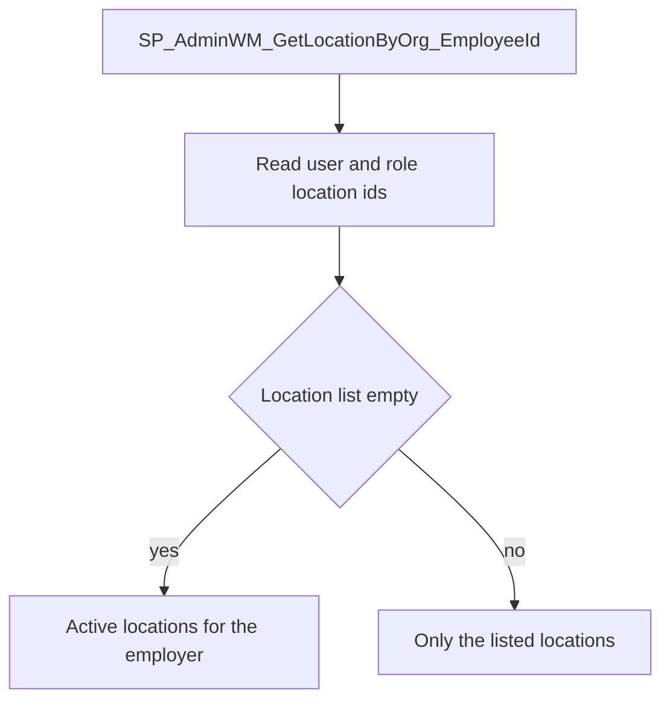

# SP_AdminWM_GetLocationByOrg_EmployeeId

## What it does

Returns active locations the employee may use. It reads the user's role, then location ids from user page mapping and role page mapping. An empty location list returns every active location for the employer. A populated list returns only those location ids.

## Parameters

| Name | Direction | What it is for |
|---|---|---|
| `@EmployeeId` | in | User whose access is checked |
| `@EmployerId` | in | Employer used when location access is unrestricted |

## Call sequence

Calls no other procedures or functions.

## Callers

No other procedure or function calls this object.

## Nested

Calls no other procedures or functions.

## Steps

1. Read role and employer from `TUsers` through `TUserEmployee` (`SP_AdminWM_GetLocationByOrg_EmployeeId.sql`).
2. Read `LocationIds` from `TUSerPagesMapping`, then append role location ids from `TRolePagesMapping` when the user list is empty.
3. Return active `TLocation` rows joined to `TEmployerDetails` and `TCOUNTRY`.
4. When location ids are empty, filter by `@EmployerId`. Otherwise filter by the split location ids.

## Tables

| Table | Read or write |
|---|---|
| `dbo.TUsers` | read |
| `dbo.TUserEmployee` | read |
| `dbo.TUSerPagesMapping` | read |
| `dbo.TRolePagesMapping` | read |
| `dbo.TLocation` | read |
| `dbo.TEmployerDetails` | read |
| `dbo.TCOUNTRY` | read |

## Flow

