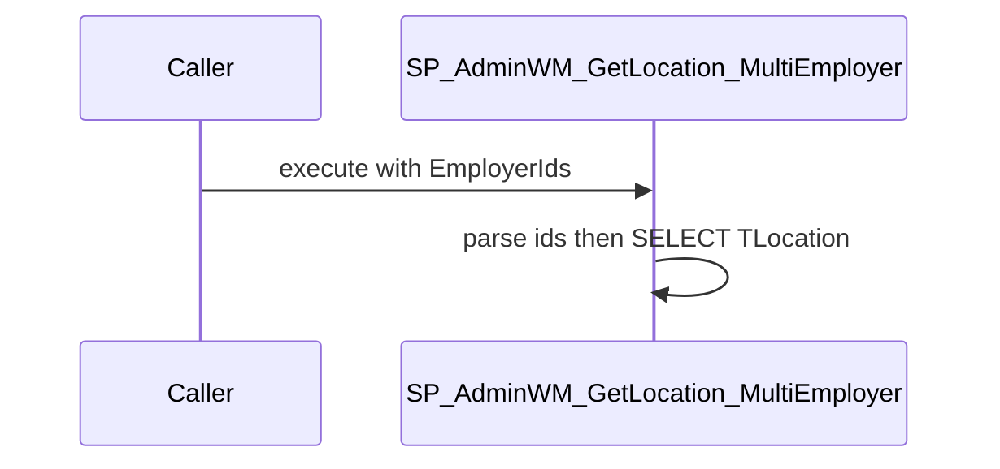
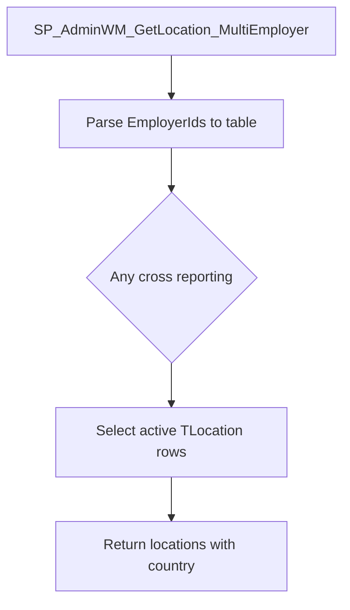

# SP_AdminWM_GetLocation_MultiEmployer

## What it does

Returns active locations for a comma-separated list of employer ids. Employer ids are parsed once into a typed table (blanks / non-numeric values ignored). If any selected employer has `IsCrossReportingApplicable = 'Y'`, location labels append ` - (EmployerName)`; otherwise the plain `LocationName` is returned. Includes country name and the usual location address / timezone columns.

## Parameters

| Name | Direction | What it is for |
|---|---|---|
| `@EmployerIds` | in | Comma-separated employer ids (for example `25,26,27`) |

## Call sequence

Calls no other procedures or functions.

## Callers

| Object | Kind | Page |
|---|---|---|
| `seperationDashboardDAL.GetLocations` | app | [Separation Dashboard](/docs/guides/separation/separation-dashboard) |

## Nested

Calls no other procedures or functions.

## Steps

From `HRMS-DATABASE/HRMS/STOREPROCEDURE/SP_AdminWM_GetLocation_MultiEmployer.sql`:

1. Insert distinct `TRY_CAST` ints from `STRING_SPLIT(@EmployerIds, ',')` into `@Employers`.
2. Set `@Lv_IsCrossReportingApplicable` to `Y` if any matched `TEmployerDetails` row has cross reporting on.
3. Select active (`IsActive = 1`) `TLocation` rows for those employers, join `TEmployerDetails` and `TCOUNTRY`, and format `LocationName` based on the cross-reporting flag.
4. Order by `LocationName`.

## Tables

| Table | Read or write |
|---|---|
| `dbo.TEmployerDetails` | read |
| `dbo.TLocation` | read |
| `dbo.TCOUNTRY` | read |

## Unresolved calls

None.

## Flow

