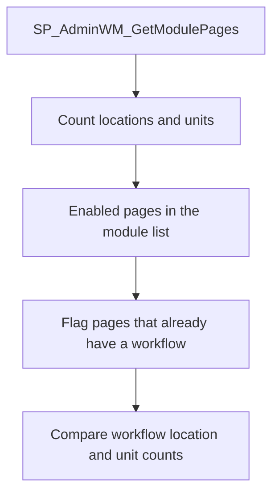

# SP_AdminWM_GetModulePages

## What it does

Lists enabled module pages, optionally limited to a comma-separated set of module ids. Each page says whether a live workflow already maps it for the employer, and whether that workflow's locations and business units cover every location and unit on the employer. Results are ordered by page name.

The script begins with `USE [HRM-CL-Prod]`. The header history mentions Email Template Builder placeholder drag-and-drop (BUG 18418).

## Parameters

| Name | Direction | What it is for |
|---|---|---|
| `@EmployerId` | in | Organisation used for workflow, location, and unit counts |
| `@ModuleIds` | in | Optional comma-separated module ids. Null or blank means every enabled page |

## Call sequence

Calls no other procedures or functions.

## Callers

No other procedure or function calls this object.

The Email Template Builder page list calls it from `node_server/routes/modules.js`, once per module id, with employer 10.

## Nested

Calls no other procedures or functions.

## Steps

1. Count locations on `TLocation` and units on `TOrgHierarchyDetails` for `@EmployerId` (`SP_AdminWM_GetModulePages.sql`).
2. Read `RootEmployerId` from `TEmployerDetails`.
3. Select distinct enabled pages (`IsEnable` = `Y`) joined to `THrmsModules`.
4. Keep a page when `@ModuleIds` is blank, or when `PageModuleId` is one of the split values.
5. Keep it when `@EmployerId` is 0 or `TEmployerModule.EmployerId` is the root employer.
6. Set `IsUsed` to `Y` when `TWorkflowManagement` has an enabled, not-deleted row for this employer whose `MappedPages` equals the page id.
7. Left-join a workflow that is also all-business-unit or all-location, then compare its `TWorkFlowLocations` and `TWorkFlowBusinessUnits` counts with the employer totals. The selected-location count drives `IsAllBUUsed`, and the selected-unit count drives `IsAllLocationUsed`.

## Tables

| Table | Read or write |
|---|---|
| `TLocation` | read |
| `TOrgHierarchyDetails` | read |
| `TEmployerDetails` | read |
| `TModulePages` | read |
| `THrmsModules` | read |
| `TEmployerModule` | read |
| `TWorkflowManagement` | read |
| `TWorkFlowLocations` | read |
| `TWorkFlowBusinessUnits` | read |

## Flow

