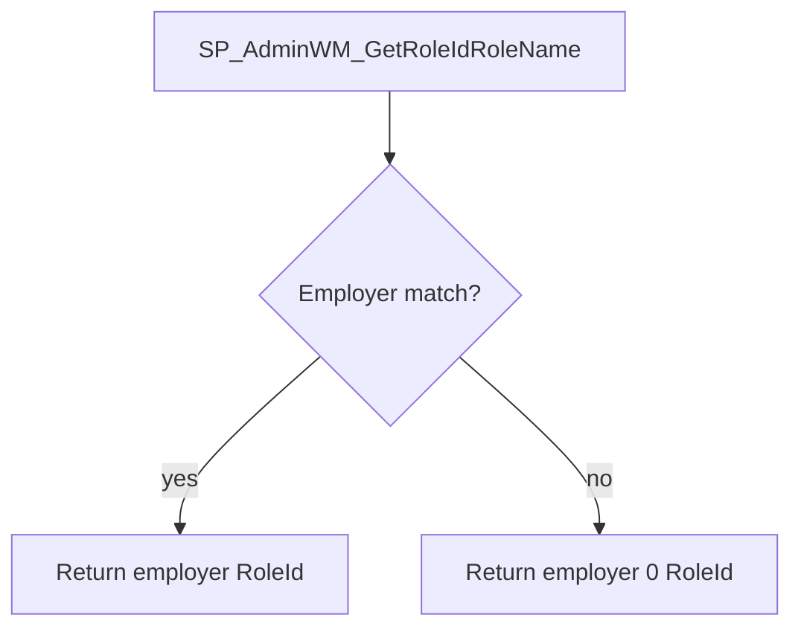

# SP_AdminWM_GetRoleIdRoleName

## What it does

Resolves a workflow group name to a `RoleId`. Prefers a non-deleted `TRoleManagement` row for the given employer; if none matches, falls back to employer `0` with the same name.

The script begins with `USE [HRM-CL-Prod]`.

## Parameters

| Name | Direction | What it is for |
|---|---|---|
| `@RoleName` | in | Group name (trimmed in the predicate) |
| `@EmployerId` | in | Organisation to search first |

## Call sequence

Calls no other procedures or functions.

## Callers

No other procedure or function calls this object.

Node `WorkflowDAL.GetEmployeeIdByRoleName` calls it while materialising group nodes from the tree.

## Nested

Calls no other procedures or functions.

## Steps

1. Look up `RoleId` on `TRoleManagement` for `@EmployerId`, `IsDelete = 0`, trimmed name match (`SP_AdminWM_GetRoleIdRoleName.sql`).
2. When found, return that `RoleId`.
3. Otherwise return matching employer-`0` rows with the same name and `IsDelete = 0`.

## Tables

| Table | Read or write |
|---|---|
| `TRoleManagement` | read |

## Flow

