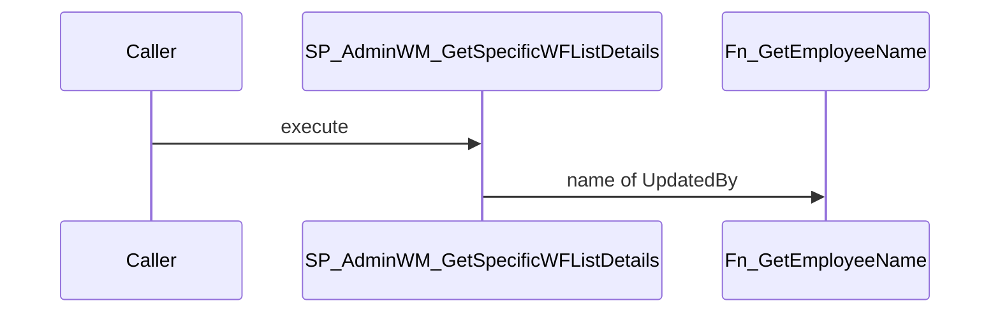
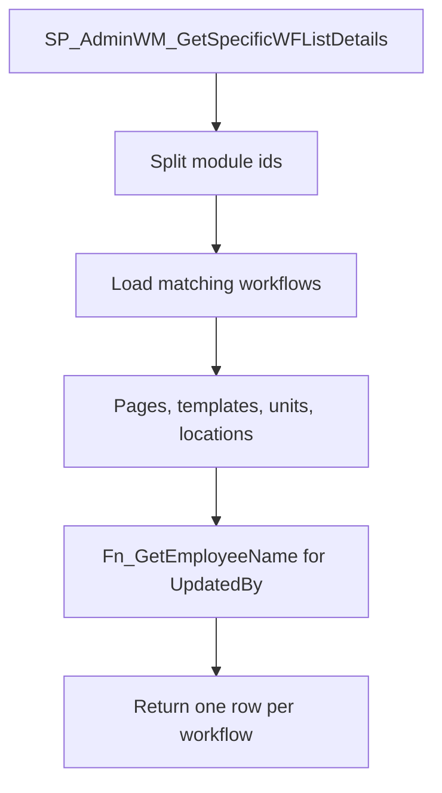

# SP_AdminWM_GetSpecificWFListDetails

## What it does

Lists workflows for an employer and a set of modules. User type `S` sees default workflows. Every other type sees non-default workflows. Optional business-unit and location filters keep workflows mapped to that unit or location. The result includes mapped page names, active template types already stored for the workflow, unit and location names, and whether workflow details exist.

The script begins with `USE [HRM-CL-Prod]`.

## Parameters

| Name | Direction | What it is for |
|---|---|---|
| `@EmployerId` | in | Organisation |
| `@ModuleIds` | in | Comma-separated module ids |
| `@UserType` | in | `S` selects default workflows. Any other value selects non-default workflows |
| `@BusinessUnitID` | in | Optional unit filter. Default null |
| `@LocationId` | in | Optional location filter. Default null |

## Call sequence

## Callers

No other procedure or function calls this object.

A data script under `DDL/73187` executes it. That script is not a procedure. The Email Template Builder workflow list calls it from `node_server/routes/modules.js` with employer 10 and user type `A`.

## Nested

| Object | Kind | When | Page |
|---|---|---|---|
| `Fn_GetEmployeeName` | function | once per result row, for `UpdatedBy` | [Fn_GetEmployeeName](/docs/database/hrms/Fn_GetEmployeeName) |

## Steps

1. Split `@ModuleIds` into integers and ignore values that do not convert (`SP_AdminWM_GetSpecificWFListDetails.sql`).
2. Insert matching `TWorkflowManagement` rows into `#WF`. Join `TEmployerDetails`. Keep `IsDelete` = 0 and this employer. User type `S` keeps `Isdefault` = 1. Other types keep `Isdefault` = 0.
3. When `@BusinessUnitID` is set, keep workflows with `IsBUMapped` = 1 and a `TWorkFlowBusinessUnits` row for that unit. Apply the same pattern for `@LocationId` and `TWorkFlowLocations`.
4. Build comma-separated active unit names and active location names for the employer.
5. `#Defined` holds workflow ids that have a non-deleted `TWorkflowDetails` row.
6. `#Templates` holds distinct active, non-deleted `TEmailTemplates.TemplateType` values for each workflow and employer.
7. `#Pages` splits `MappedPages` and aggregates `TModulePages.ModulePageName`.
8. `#Units` and `#Locations` aggregate names from the workflow's unit and location maps. A null aggregate falls back to the employer-wide list and is flagged as all units or all locations.
9. Return the workflow, `WorkflowDefinitionTree`, `Fn_GetEmployeeName(UpdatedBy)`, page list, template types, `WorkflowDefined`, unit and location names, and `IsNotificationOnlyWorkFlow` from `TModulePages` where `MappedPages` equals `ModulePageId`. Order by workflow name.

## Tables

| Table | Read or write |
|---|---|
| `TWorkflowManagement` | read |
| `TEmployerDetails` | read |
| `TWorkFlowBusinessUnits` | read |
| `TWorkFlowLocations` | read |
| `TOrgHierarchyDetails` | read |
| `TLocation` | read |
| `TWorkflowDetails` | read |
| `TEmailTemplates` | read |
| `TModulePages` | read |

## Flow

