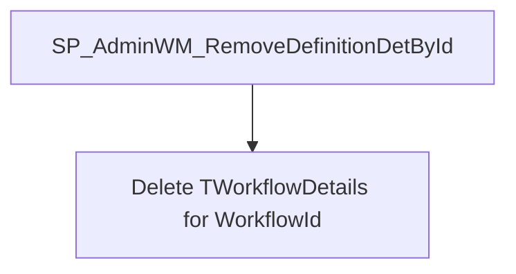

# SP_AdminWM_RemoveDefinitionDetById

## What it does

Hard-deletes every `TWorkflowDetails` row for a workflow id. Define Workflow save calls this before re-inserting materialised approval levels from the new XML tree.

## Parameters

| Name | Direction | What it is for |
|---|---|---|
| `@WorkflowId` | in | Workflow whose detail rows are removed |

## Call sequence

Calls no other procedures or functions.

## Callers

No other procedure or function calls this object.

Node `WorkflowDAL.RemoveExistingWorkFlowDetails` calls it from `ProcessWorkFlowXml`.

## Nested

Calls no other procedures or functions.

## Steps

1. `DELETE FROM TWorkflowDetails WHERE WorkflowId = @WorkflowId` (`SP_AdminWM_RemoveDefinitionDetById.sql`).

## Tables

| Table | Read or write |
|---|---|
| `TWorkflowDetails` | write |

## Flow

