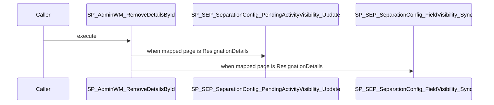
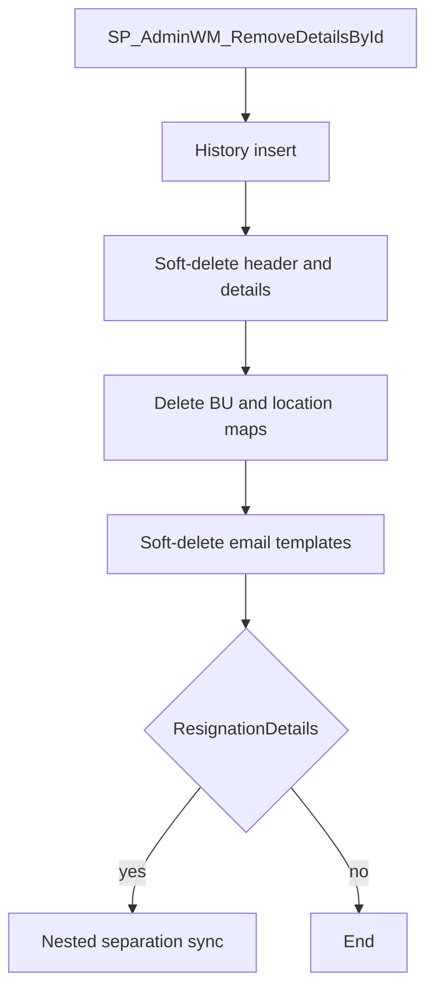

# SP_AdminWM_RemoveDetailsById

## What it does

Soft-deletes a workflow definition: copies the header to `TWorkflowManagement_History` with action `Record Deleted`, sets `IsDelete` on `TWorkflowManagement` and `TWorkflowDetails`, hard-deletes BU/location map rows, soft-deletes `TEmailTemplates` for that workflow, and when the mapped page name is `ResignationDetails` runs two separation-config sync procedures.

## Parameters

| Name | Direction | What it is for |
|---|---|---|
| `@WorkflowId` | in | Header to remove |
| `@UpdatedBy` | in | Deleting employee |

## Call sequence

## Callers

No other procedure or function calls this object. Application caller: `WorkflowManagementDAL.RemoveSelectedWFFromWorkFlowList`.

## Nested

| Object | Kind | When | Page |
|---|---|---|---|
| `SP_SEP_SeparationConfig_PendingActivityVisibility_Update` | procedure | mapped page name is `ResignationDetails` | [SP_SEP_SeparationConfig_PendingActivityVisibility_Update](/docs/database/hrms/SP_SEP_SeparationConfig_PendingActivityVisibility_Update) |
| `SP_SEP_SeparationConfig_FieldVisibility_Sync` | procedure | mapped page name is `ResignationDetails` | [SP_SEP_SeparationConfig_FieldVisibility_Sync](/docs/database/hrms/SP_SEP_SeparationConfig_FieldVisibility_Sync) |

## Steps

1. Insert current header into `TWorkflowManagement_History` with `'Record Deleted'` (`SP_AdminWM_RemoveDetailsById.sql`).
2. Soft-delete `TWorkflowManagement` and `TWorkflowDetails` for `@WorkflowId`.
3. Delete `TWorkFlowBusinessUnits` and `TWorkFlowLocations` rows for that id.
4. Soft-delete `TEmailTemplates` where `WorkflowId` matches.
5. When joined `TModulePages.ModulePageName` equals `ResignationDetails`, execute the two nested separation procedures.

## Tables

| Table | Read or write |
|---|---|
| `TWorkflowManagement` | read then write |
| `TWorkflowManagement_History` | write |
| `TWorkflowDetails` | write |
| `TWorkFlowBusinessUnits` | read then delete |
| `TWorkFlowLocations` | read then delete |
| `TEmailTemplates` | write |
| `TModulePages` | read |

## Flow

