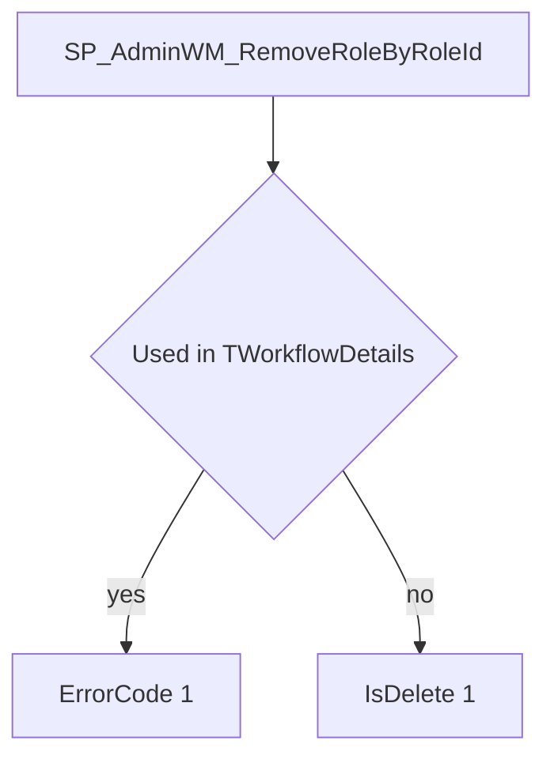

# SP_AdminWM_RemoveRoleByRoleId

## What it does

Soft-deletes one workflow group. If any non-deleted `TWorkflowDetails` row still uses the role id as `ManagerId`, it returns an error and leaves the group active. Otherwise it sets `TRoleManagement.IsDelete = 1` and stamps `UpdatedBy` / `UpdatedDate`.

## Parameters

| Name | Direction | What it is for |
|---|---|---|
| `@RoleId` | in | Group to remove |
| `@UpdatedBy` | in | Acting employee |

## Call sequence

Calls no other procedures or functions.

## Callers

| Object | Kind | Page |
|---|---|---|
| Application only | WebForms DAL | Workflow Group Setup |

`WorkflowManagementDAL.RemoveSelectedRoleFromRoleList` executes this procedure.

## Nested

Calls no other procedures or functions.

## Steps

1. Count `TWorkflowDetails` where `ManagerId = @RoleId` and `IsDelete = 0`.
2. When count > 0, return `ErrorCode` 1 and message that the role cannot be deleted.
3. Otherwise update `TRoleManagement` set `IsDelete = 1` and return success message.

## Tables

| Table | Read or write |
|---|---|
| `TWorkflowDetails` | read |
| `TRoleManagement` | write |

## Flow

