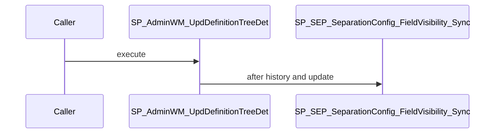
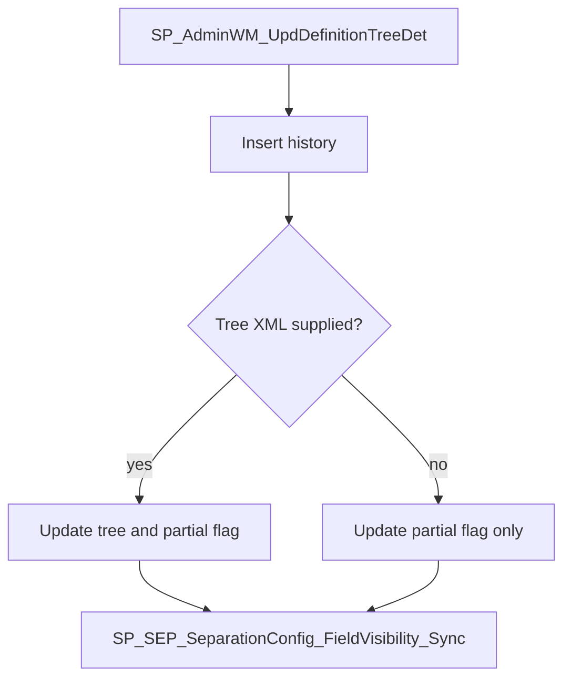

# SP_AdminWM_UpdDefinitionTreeDet

## What it does

Writes a history snapshot of the current `TWorkflowManagement` row, then updates that row's `WorkflowDefinitionTree` XML (when supplied), `UpdatedBy` / `UpdatedDate`, and `IsWorkflowPartial`. Always finishes by calling the resignation field-visibility sync for the same workflow id (that callee returns immediately for non-Resignation mappings).

## Parameters

| Name | Direction | What it is for |
|---|---|---|
| `@WorkflowId` | in | Workflow to update |
| `@WorkflowDefinitionTree` | in | New XML. Null skips the tree column update |
| `@UpdatedBy` | in | Employee performing the save |
| `@IsWorkflowPartial` | in | Partial-tree flag |

## Call sequence

## Callers

No other procedure or function calls this object.

Node `WorkflowDAL.UpdateWorkflowDefinitionTreeDetails` calls it from Define Workflow save.

## Nested

| Object | Kind | When | Page |
|---|---|---|---|
| `SP_SEP_SeparationConfig_FieldVisibility_Sync` | procedure | always after the update | [SP_SEP_SeparationConfig_FieldVisibility_Sync](/docs/database/hrms/SP_SEP_SeparationConfig_FieldVisibility_Sync) |

## Steps

1. Insert the current `TWorkflowManagement` row into `TWorkflowManagement_History` with action `Record Updated` (`SP_AdminWM_UpdDefinitionTreeDet.sql`).
2. When `@WorkflowDefinitionTree` is not null, update tree, updater, date, and `IsWorkflowPartial` where `Isdelete = 0`.
3. Otherwise update only `IsWorkflowPartial` and updater for the active row.
4. Execute `SP_SEP_SeparationConfig_FieldVisibility_Sync` with the same `@WorkflowId`.

## Tables

| Table | Read or write |
|---|---|
| `TWorkflowManagement` | read, write |
| `TWorkflowManagement_History` | write |

## Flow

