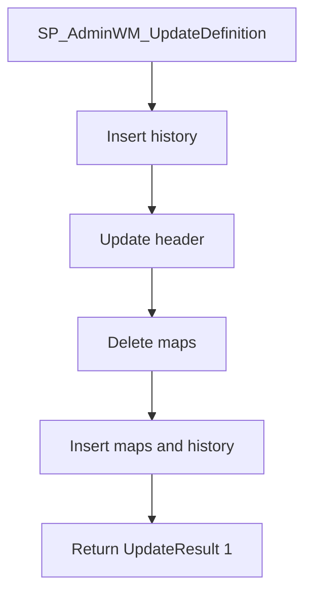

# SP_AdminWM_UpdateDefinition

## What it does

Copies the current `TWorkflowManagement` row into `TWorkflowManagement_History` with action `Record Updated`, updates the live header (when `IsDelete` = 0), deletes and re-inserts location and business-unit maps from the input CSV lists, and writes map history rows. Returns `UpdateResult` = 1.

## Parameters

| Name | Direction | What it is for |
|---|---|---|
| `@Employerid` | in | Tenant (passed by DAL; not used in the UPDATE WHERE) |
| `@WorkflowId` | in | Header to update |
| `@WorkflowName` | in | Name |
| `@WorkflowDescription` | in | Description |
| `@RoutingLevels` | in | Max levels |
| `@MappedPages` | in | Mapped page id string |
| `@UpdatedBy` | in | Updating employee |
| `@IsDefaultWorkFlow` | in | Default flag |
| `@ISEnable` | in | Enabled flag |
| `@ModuleId` | in | Module |
| `@IsLocationMapped` | in | Location scoped |
| `@IsBUMapped` | in | BU scoped |
| `@IsAllBUSelected` | in | All BUs |
| `@IsAllLocationSelected` | in | All locations |
| `@Locations` | in | CSV location ids |
| `@BusinessUnitIDs` | in | CSV BU ids |

## Call sequence

Calls no other procedures or functions.

## Callers

No other procedure or function calls this object. Application caller: `WorkflowManagementDAL.UpdateWorkflowDefinition`.

## Nested

Calls no other procedures or functions.

## Steps

1. Insert the current header into `TWorkflowManagement_History` with `@UpdatedBy` / `GETDATE()` / `'Record Updated'` (`SP_AdminWM_UpdateDefinition.sql`).
2. Update `TWorkflowManagement` for `@WorkflowId` where `IsDelete` = 0.
3. Delete existing `TWorkFlowLocations` and `TWorkFlowBusinessUnits` for that workflow.
4. Re-insert locations and BUs from `STRING_SPLIT`, then insert matching history rows.
5. Select `1` as `UpdateResult`.

## Tables

| Table | Read or write |
|---|---|
| `TWorkflowManagement` | read then write |
| `TWorkflowManagement_History` | write |
| `TWorkFlowLocations` | delete then write |
| `TWorkFlowBusinessUnits` | delete then write |
| `TWorkFlowLocationsHistory` | write |
| `TWorkFlowBusinessUnitsHistory` | write |

## Flow

