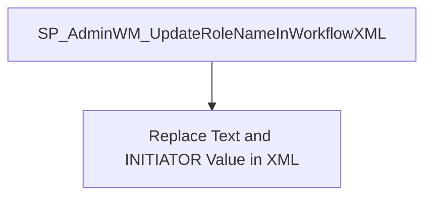

# SP_AdminWM_UpdateRoleNameInWorkflowXML

## What it does

After a workflow group rename, replaces the old group name inside `TWorkflowManagement.WorkflowDefinitionTree` XML for the employer (and employer **0**). It updates `Text="…"` attributes and `Value="INITIATOR :: …"` initiator values that still hold the old name.

## Parameters

| Name | Direction | What it is for |
|---|---|---|
| `@OldRoleName` | in | Previous group name |
| `@NewRoleName` | in | New group name |
| `@EmployerID` | in | Organisation scope (also updates employer 0 rows) |

## Call sequence

Calls no other procedures or functions.

## Callers

| Object | Kind | Page |
|---|---|---|
| Application only | WebForms DAL | Workflow Group Setup after UpdateRoles |

`WorkflowManagementDAL.UpdateRoleNameInWorkflowXML` runs this when the old name differs from the new name.

## Nested

Calls no other procedures or functions.

## Steps

1. `UPDATE TWorkflowManagement` set `WorkflowDefinitionTree` with nested `REPLACE` for `Text="Old"` and `Value="INITIATOR :: Old"`.
2. Limit to `EmployerID` in (`@EmployerID`, `0`), `IsDelete = 0`, and trees that still contain the old `Text` attribute.

## Tables

| Table | Read or write |
|---|---|
| `TWorkflowManagement` | write |

## Flow

