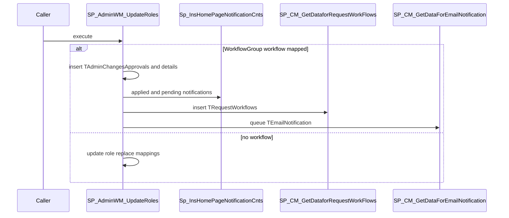
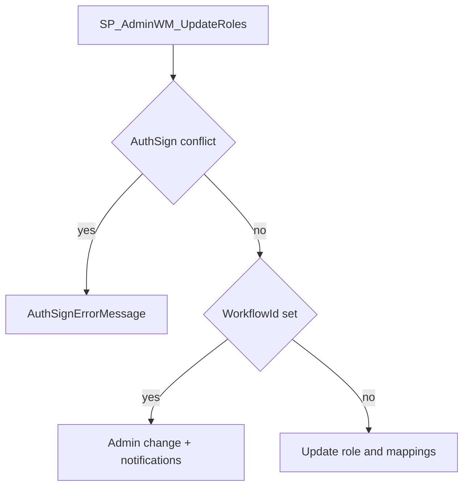

# SP_AdminWM_UpdateRoles

## What it does

Updates one workflow group. It blocks a duplicate authorized-signatory flag, then either writes pending admin-change rows (when a `WorkflowGroup` workflow is mapped) or updates `TRoleManagement` and replaces the three mapping tables. The approval path builds notifications and `TRequestWorkflows` rows itself — it does **not** call `SP_AddAdminChanges`.

## Parameters

| Name | Direction | What it is for |
|---|---|---|
| `@RoleId` | in | Existing group id |
| `@RoleName` | in | New name |
| `@RoleDescription` | in | Details |
| `@EffectiveDate` | in | Effective-from date |
| `@LocationId` | in | Comma-separated locations |
| `@BusinessUnitId` | in | Comma-separated business units |
| `@EmployeeID` | in | Comma-separated employees |
| `@UpdatedBy` | in | Acting employee |
| `@Employerid` | in | Organisation |
| `@IsAuthSign` | in | Authorized signatory flag |
| `@IsActive` | in | Active flag |

## Call sequence

## Callers

| Object | Kind | Page |
|---|---|---|
| Application only | WebForms DAL | Workflow Group Setup |

`WorkflowManagementDAL.UpdateRoles` executes this procedure. After success the DAL may call `SP_AdminWM_UpdateRoleNameInWorkflowXML` when the name changed.

## Nested

| Object | Kind | When | Page |
|---|---|---|---|
| `Split` | function | cursor over table-name list; old mapping csv | [Split](/docs/database/hrms/Split) |
| `Fn_GetHomePageNotificationIdByRequestType` | function | approval path | [Fn_GetHomePageNotificationIdByRequestType](/docs/database/hrms/Fn_GetHomePageNotificationIdByRequestType) |
| `Sp_InsHomePageNotificationCnts` | procedure | approval path | [Sp_InsHomePageNotificationCnts](/docs/database/hrms/Sp_InsHomePageNotificationCnts) |
| `SP_CM_GetDataforRequestWorkFlows` | procedure | insert pending routing rows | [SP_CM_GetDataforRequestWorkFlows](/docs/database/hrms/SP_CM_GetDataforRequestWorkFlows) |
| `FN_CM_GetMgrFromRequestWorkflows` | function | pending L1 manager list | [FN_CM_GetMgrFromRequestWorkflows](/docs/database/hrms/FN_CM_GetMgrFromRequestWorkflows) |
| `FN_CM_GetApproverList` | function | email recipients | [FN_CM_GetApproverList](/docs/database/hrms/FN_CM_GetApproverList) |
| `SP_CM_GetDataForEmailNotification` | procedure | queue email notification | [SP_CM_GetDataForEmailNotification](/docs/database/hrms/SP_CM_GetDataForEmailNotification) |

## Steps

1. Reject duplicate auth-sign for another role on the same employer.
2. Resolve `WorkflowGroup` `WorkflowId` and `@Lv_UpdateBy` (workflow manager employee when updater is from another org).
3. When workflow exists: validate no pending change for the same table id; insert `TAdminChangesApprovals` / details; fill OldValue; short-circuit if nothing changed; notify; insert `TRequestWorkflows` and `TEmailNotification`.
4. When no workflow: update `TRoleManagement` and replace mapping rows via `string_split`.

## Tables

| Table | Read or write |
|---|---|
| `TRoleManagement` | read / write |
| `TWorkflowManagement` | read |
| `TModulePages` | read |
| `TEmployeeInfo` | read |
| `tRoleEmployeeMapping` | read / write |
| `tRoleLocationMapping` | read / write |
| `tRoleBusinessUnitMapping` | read / write |
| `TAdminChangesApprovals` | write on approval path |
| `TAdminChangesApprovalDetails` | write on approval path |
| `TRequestWorkflows` | write on approval path |
| `TEmailNotification` | write on approval path |
| `TWorkflowDetails` | read for manager role |

## Flow

