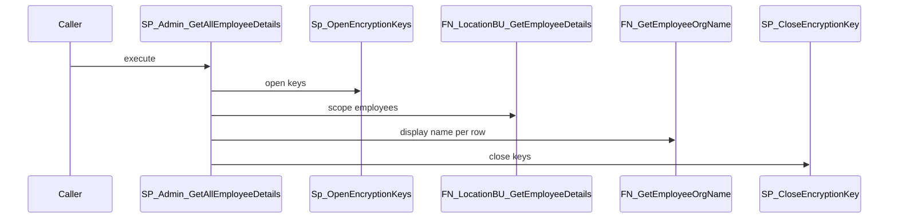
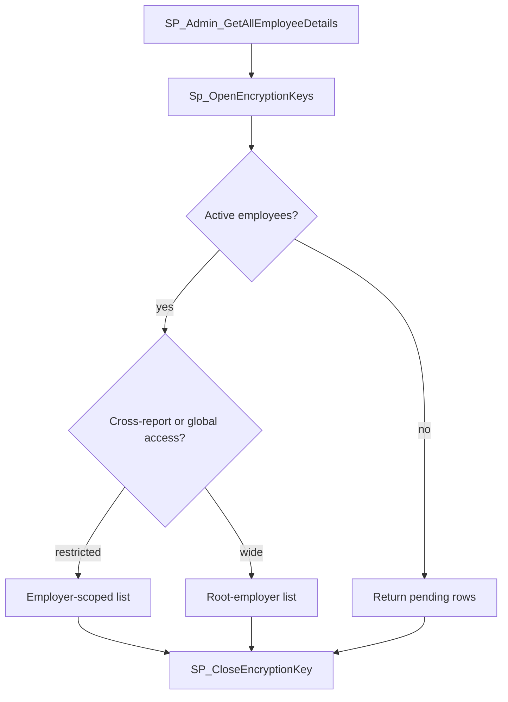

# SP_Admin_GetAllEmployeeDetails

## What it does

Returns active employees visible to the calling user for an employer (and, when cross-reporting / global access allows, across the root organisation). Opens encryption keys, scopes rows through `FN_LocationBU_GetEmployeeDetails`, names people with `FN_GetEmployeeOrgName`, optionally excludes a candidate referrer, and closes encryption keys. When the employer has no active employees it returns pending (`IsActive = 'P'`) rows for that employer instead.

## Parameters

| Name | Direction | What it is for |
|---|---|---|
| `@EmployerId` | in | Organisation being listed |
| `@CandidateId` | in | Optional candidate whose referrer is excluded. Default null; `0` treated as null |
| `@EmployeeId` | in | Calling employee (access / location-BU scope) |

## Call sequence

## Callers

No other procedure or function calls this object.

Node Define Workflow loads the people picker via `WorkflowDAL.GetAllEmployeeDetails`.

## Nested

| Object | Kind | When | Page |
|---|---|---|---|
| `Sp_OpenEncryptionKeys` | procedure | start of the body | [Sp_OpenEncryptionKeys](/docs/database/hrms/Sp_OpenEncryptionKeys) |
| `FN_LocationBU_GetEmployeeDetails` | function | employer-scoped and cross-reporting branches | [FN_LocationBU_GetEmployeeDetails](/docs/database/hrms/FN_LocationBU_GetEmployeeDetails) |
| `FN_GetEmployeeOrgName` | function | name / EmpName columns | [FN_GetEmployeeOrgName](/docs/database/hrms/FN_GetEmployeeOrgName) |
| `SP_CloseEncryptionKey` | procedure | end of the body | [SP_CloseEncryptionKey](/docs/database/hrms/SP_CloseEncryptionKey) |

## Steps

1. Execute `Sp_OpenEncryptionKeys` (`SP_Admin_GetAllEmployeeDetails.sql`).
2. When the employer has active employees, read cross-reporting and the caller's global-access flag.
3. Treat `@CandidateId = 0` as null.
4. When cross-reporting is off or the caller lacks global access, return active employees for `@EmployerId` scoped by `FN_LocationBU_GetEmployeeDetails(@EmployeeId, @EmployerId)`.
5. Otherwise return active employees under the root employer scoped by `FN_LocationBU_GetEmployeeDetails(@EmployeeId, NULL)`.
6. When no active employees exist, return pending employees for `@EmployerId`.
7. Execute `SP_CloseEncryptionKey`.

## Tables

| Table | Read or write |
|---|---|
| `TEmployee` | read |
| `TEmployeeInfo` | read |
| `TTitle` | read |
| `TEmployerDetails` | read |
| `TUsers` | read |
| `TUserEmployee` | read |
| `TRRSCandidate` | read |

## Flow

