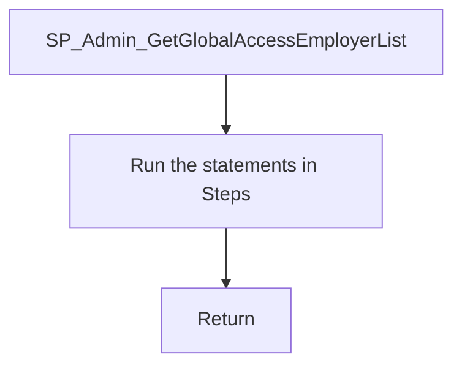

# SP_Admin_GetGlobalAccessEmployerList

## What it does

Returns employers that share the root employer of @EmployerId and are not deleted. Columns are EmployerName, custid, ParentCustid, Employerid, ParentEmployerid, and RootEmployerId.

## Parameters

| Name | Direction | What it is for |
|---|---|---|
| `@EmployerId` | in | Employer whose root scopes the list |

## Call sequence

Calls no other procedures or functions.

## Callers

No other procedure or function calls this object.

## Nested

Calls no other procedures or functions.

## Steps

1. Read RootEmployerId from temployerdetails for @EmployerId.
2. Return every temployerdetails row with that root and IsDeleted 0.

## Tables

| Table | Read or write |
|---|---|
| `temployerdetails` | read |

## Flow

