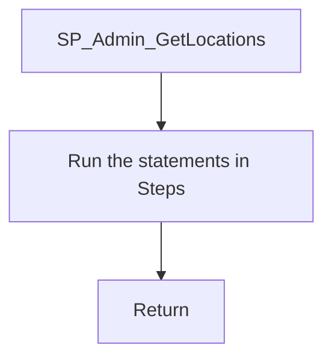

# SP_Admin_GetLocations

## What it does

Returns active locations for every employer id in a comma-separated list, with the employer name on the location label and the country name.

## Parameters

| Name | Direction | What it is for |
|---|---|---|
| `@Employerid` | in | Comma-separated employer ids |

## Call sequence

Calls no other procedures or functions.

## Callers

No other procedure or function calls this object.

## Nested

Calls no other procedures or functions.

## Steps

1. Split @Employerid and join TEmployerDetails to active TLocation rows.
2. Join TCOUNTRY for the country name and order by location name.

## Tables

| Table | Read or write |
|---|---|
| `TEmployerDetails` | read |
| `TLocation` | read |
| `TCOUNTRY` | read |

## Flow

