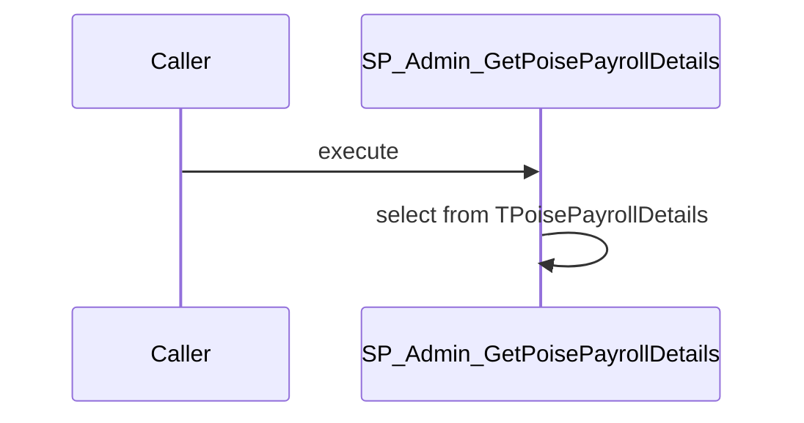
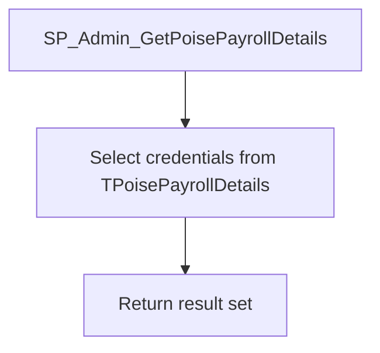

# SP_Admin_GetPoisePayrollDetails

## What it does

Returns the Poise payroll redirect credentials for one employer. Payroll Details (`PayrolIntegration.aspx`) uses the row to open an external payroll login. The procedure selects `UserName`, `Password`, `RedirectionUrl`, `StaticText`, and `EssUrl` from `TPoisePayrollDetails` where `employerid` equals `@EmployerId`. It does not filter on `IsActive` and does not call other procedures or functions.

The Liquibase inventory has no matching `.sql` file. The body documented here was read from DEV via `OBJECT_DEFINITION(OBJECT_ID('dbo.SP_Admin_GetPoisePayrollDetails'))`.

## Parameters

| Name | Direction | What it is for |
|---|---|---|
| `@EmployerId` | in | Employer whose `TPoisePayrollDetails` row to return |

## Call sequence

Calls no other procedures or functions.

## Callers

| Object | Kind | Page |
|---|---|---|
| `DBHelper.GetPoisePayrollDetails` | app | [Payroll Details](/docs/guides/admin-configuration/payroll-details) (`PayrolIntegration.aspx.cs`) |

No other procedure in `STOREPROCEDURE/` executes it. The related scheduler procedure `SP_Get_PoisePayRollDetails` is a separate object.

## Nested

None.

## Steps

From the DEV procedure body:

1. Select `UserName`, `Password`, `RedirectionUrl`, `StaticText`, and `EssUrl` from `TPoisePayrollDetails` where `employerid = @EmployerId`.
2. Return that result set. Multiple rows for the same employer are all returned; the page uses `Rows[0]`.

## Tables

| Table | Read or write |
|---|---|
| `dbo.TPoisePayrollDetails` | read |

## Unresolved calls

None.

## Flow

