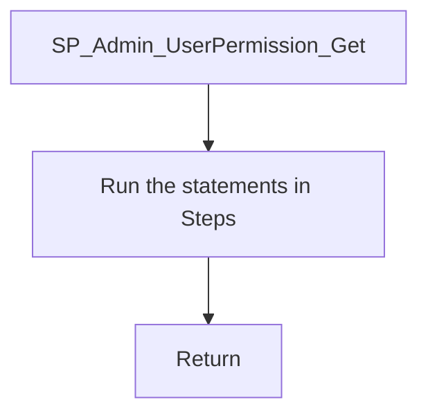

# SP_Admin_UserPermission_Get

## What it does

Returns three result sets for one user: the role name, the location ids (role defaults marked IsDefault 1, extra user locations marked 0), and the business unit ids in the same shape.

## Parameters

| Name | Direction | What it is for |
|---|---|---|
| `@EmployerId` | in | Employer on the user and the mapping rows |
| `@UserId` | in | User being opened |

## Call sequence

Calls no other procedures or functions.

## Callers

No other procedure or function calls this object.

## Nested

Calls no other procedures or functions.

## Steps

1. Read the user's RoleId from tUsers.
2. Select RoleName from TRoles.
3. Split LocationIds and BusinessUnitIds on the role's TRolePagesMapping rows into default lists.
4. Return user-specific locations from TUSerPagesMapping that are not in the default list, unioned with the defaults.
5. Return business units the same way.

## Tables

| Table | Read or write |
|---|---|
| `tUsers` | read |
| `TRoles` | read |
| `TRolePagesMapping` | read |
| `TUserEmployee` | read |
| `TUSerPagesMapping` | read |

## Flow

