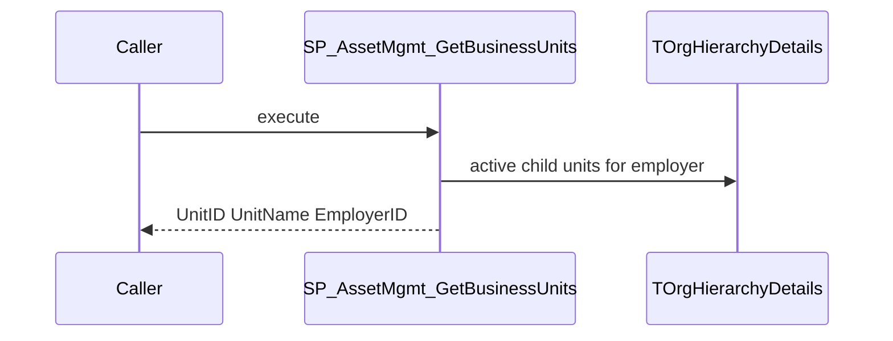
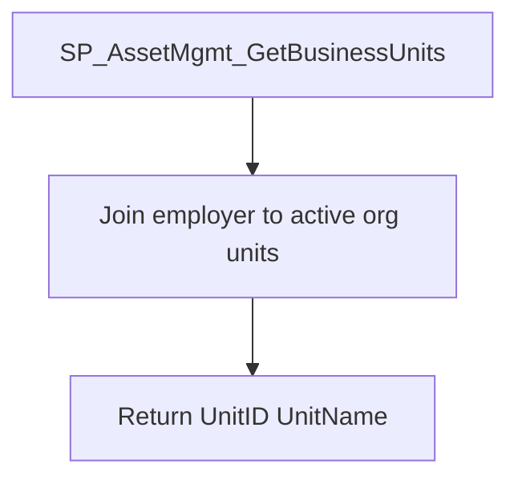

# SP_AssetMgmt_GetBusinessUnits

## What it does

Returns active organisation hierarchy units for one employer (`UnitID`, `UnitName`, `EmployerID`) where `ParentUnitid <> 0`. Used by RewardNRecognition Point Request listing (`SP_RnR_Budget_ListPointRequests`) to map an employee’s business unit id to a display name on the Notifications Point Request queue.

## Parameters

| Name | Direction | What it is for |
|---|---|---|
| `@EmployerId` | in | Employer whose org units to list |

## Call sequence

## Callers

| Object | Kind | Page |
|---|---|---|
| `SP_RnR_Budget_ListPointRequests` | procedure | [SP_RnR_Budget_ListPointRequests](/docs/database/hrms-rewardnrecognition/SP_RnR_Budget_ListPointRequests) |

## Nested

None.

## Steps

In `HRMS-DATABASE/HRMS/STOREPROCEDURE/SP_AssetMgmt_GetBusinessUnits.sql`:

1. Set `NOCOUNT` and read-uncommitted isolation.
2. Join `TEmployerDetails` to active `TOrgHierarchyDetails` for the employer with `ParentUnitid <> 0`.
3. Return units ordered by `UnitName`.

## Tables

| Table | Read or write |
|---|---|
| `dbo.TEmployerDetails` | read |
| `dbo.TOrgHierarchyDetails` | read |

## Unresolved calls

None.

## Flow

