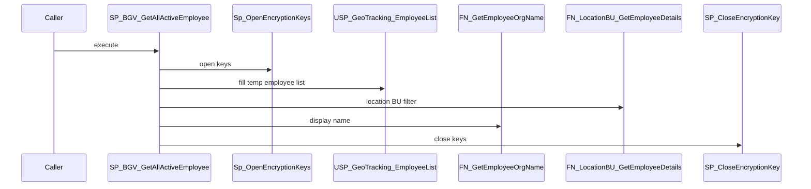
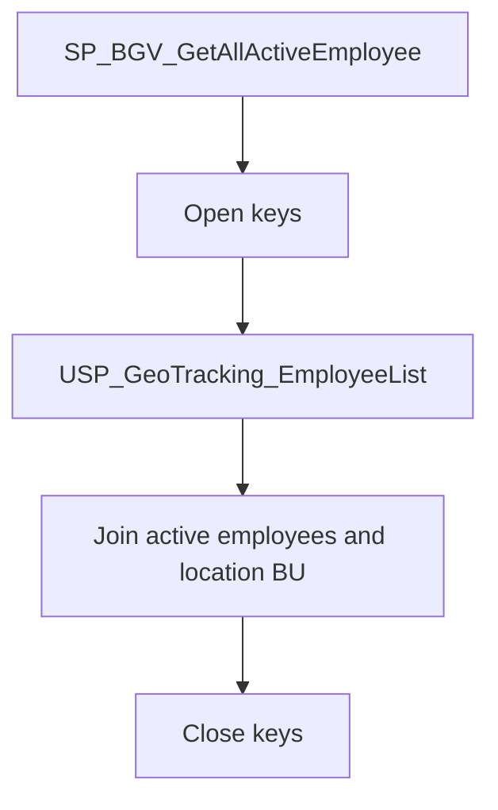

# SP_BGV_GetAllActiveEmployee

## What it does

Returns active employees the operator may search for when creating a post-employment BGV request. It builds a candidate employee set via `USP_GeoTracking_EmployeeList`, intersects with the given employer, requires `IsActive = 'Y'`, and further restricts with `FN_LocationBU_GetEmployeeDetails`. Display names use `FN_GetEmployeeOrgName`.

## Parameters

| Name | Direction | What it is for |
|---|---|---|
| `@EmployerId` | in | Employer filter |
| `@EmployeeId` | in | Operator whose visibility rules apply |

## Call sequence

## Callers

No other procedure or function calls this object. Application caller: BGV API `employeeDAL.GetAllEmployeeInfo`.

## Nested

| Object | Kind | When | Page |
|---|---|---|---|
| `Sp_OpenEncryptionKeys` | procedure | always | [Sp_OpenEncryptionKeys](/docs/database/hrms/Sp_OpenEncryptionKeys) |
| `USP_GeoTracking_EmployeeList` | procedure | always | [USP_GeoTracking_EmployeeList](/docs/database/hrms/USP_GeoTracking_EmployeeList) |
| `FN_GetEmployeeOrgName` | function | each row name | [FN_GetEmployeeOrgName](/docs/database/hrms/FN_GetEmployeeOrgName) |
| `FN_LocationBU_GetEmployeeDetails` | function | always | [FN_LocationBU_GetEmployeeDetails](/docs/database/hrms/FN_LocationBU_GetEmployeeDetails) |
| `SP_CloseEncryptionKey` | procedure | always | [SP_CloseEncryptionKey](/docs/database/hrms/SP_CloseEncryptionKey) |

## Steps

1. Script is `HRMS-DATABASE/HRMS/STOREPROCEDURE/SP_BGV_GetAllActiveEmployee.sql`.
2. `READ UNCOMMITTED`; open encryption keys.
3. Create `#Employees`; insert from `USP_GeoTracking_EmployeeList`.
4. Join `TEmployee` / `TEmployeeInfo` / `TTitle` / `TEmployerDetails` with location/BU TVF; require active employee and employer match.
5. Return id, org name, title, employer, employment number; order by name; close keys.

## Tables

| Table | Read or write |
|---|---|
| `#Employees` | write/read (temp) |
| `dbo.TEmployee` | read |
| `dbo.TEmployeeInfo` | read |
| `dbo.TTitle` | read |
| `dbo.TEmployerDetails` | read |

## Flow

