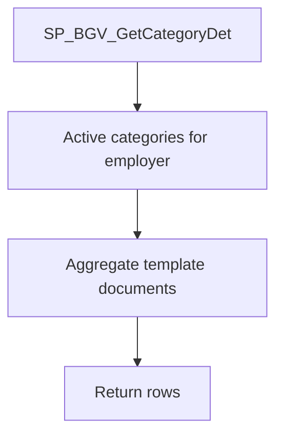

# SP_BGV_GetCategoryDet

## What it does

Returns active, non-deleted BGV categories for an employer, including `DocumentGroupID` and comma-aggregated template file names and document ids from `TDocuments` via `TDocumentGroup`.

## Parameters

| Name | Direction | What it is for |
|---|---|---|
| `@EmployerId` | in | Employer whose categories are listed |

## Call sequence

Calls no other procedures or functions.

## Callers

No other procedure or function calls this object. Application caller: BGV API `categoryDAL.GetAllCategoryInfo`.

## Nested

Calls no other procedures or functions.

## Steps

1. Script is `HRMS-DATABASE/HRMS/STOREPROCEDURE/SP_BGV_GetCategoryDet.sql`.
2. Select from `TBGVCategory` where `IsDelete = 'N'`, `Isactive = 'Y'`, and `EmployerId = @EmployerId`.
3. Aggregate document file names and ids through `TDocumentGroup` → `TDocuments`.

## Tables

| Table | Read or write |
|---|---|
| `dbo.TBGVCategory` | read |
| `dbo.TDocumentGroup` | read |
| `dbo.TDocuments` | read |

## Flow

