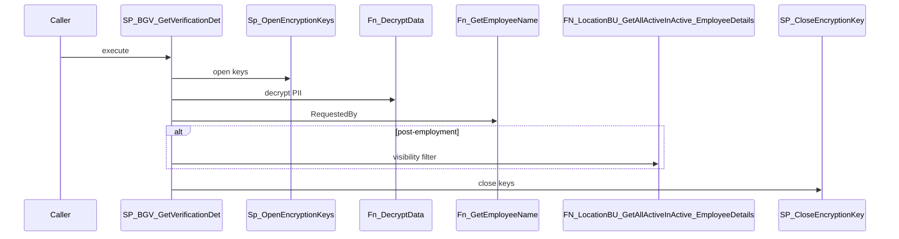
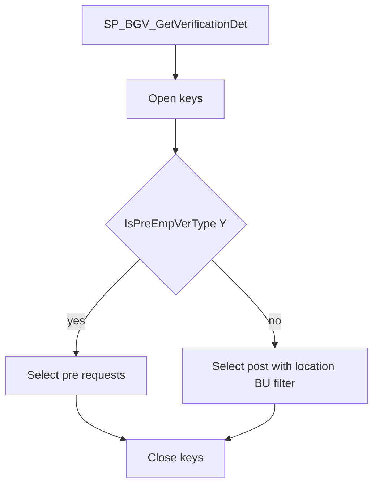

# SP_BGV_GetVerificationDet

## What it does

Returns the BGV request grid for one employer and pre/post flag. Pre-employment (`@IsPreEmpVerType = 'Y'`) lists all matching requests. Post-employment joins `TEmployee`, filters by `@IsActive` when provided, and restricts to employees visible through `FN_LocationBU_GetAllActiveInActive_EmployeeDetails` for `@LoginEmployeeId`. Names and emails are decrypted; category names are aggregated.

## Parameters

| Name | Direction | What it is for |
|---|---|---|
| `@EmployerId` | in | Employer scope |
| `@IsPreEmpVerType` | in | `Y` pre / `N` post |
| `@IsActive` | in | Optional employee active flag (post); null = all |
| `@LoginEmployeeId` | in | Operator used for location/BU visibility (post) |

## Call sequence

## Callers

No other procedure or function calls this object. Application caller: BGV API `bgverificationDAL.GetAllBGVInfo`.

## Nested

| Object | Kind | When | Page |
|---|---|---|---|
| `Sp_OpenEncryptionKeys` | procedure | always | [Sp_OpenEncryptionKeys](/docs/database/hrms/Sp_OpenEncryptionKeys) |
| `Fn_DecryptData` | function | name and email | [Fn_DecryptData](/docs/database/hrms/Fn_DecryptData) |
| `Fn_GetEmployeeName` | function | `RequestedBy` | [Fn_GetEmployeeName](/docs/database/hrms/Fn_GetEmployeeName) |
| `FN_LocationBU_GetAllActiveInActive_EmployeeDetails` | function | post-employment branch | [FN_LocationBU_GetAllActiveInActive_EmployeeDetails](/docs/database/hrms/FN_LocationBU_GetAllActiveInActive_EmployeeDetails) |
| `SP_CloseEncryptionKey` | procedure | always | [SP_CloseEncryptionKey](/docs/database/hrms/SP_CloseEncryptionKey) |

## Steps

1. Script is `HRMS-DATABASE/HRMS/STOREPROCEDURE/SP_BGV_GetVerificationDet.sql`.
2. Open encryption keys.
3. Pre branch: select decrypted grid columns from `TBGVVerificationRequest` for employer + pre flag; include status text, categories CSV, vendor name, milestone dates.
4. Post branch: same shape joined to `TEmployee` and location/BU TVF; optional `IsActive` filter.
5. Order by `VerificationId` desc; close keys.

## Tables

| Table | Read or write |
|---|---|
| `dbo.TBGVVerificationRequest` | read |
| `dbo.TEmployeeInfo` | read |
| `dbo.TBGVStatusLOOKUP` | read |
| `dbo.TBGVCategory` | read |
| `dbo.TBGVRequestCategory` | read |
| `dbo.TBGVVendor` | read |
| `dbo.TEmployee` | read (post) |

## Flow

