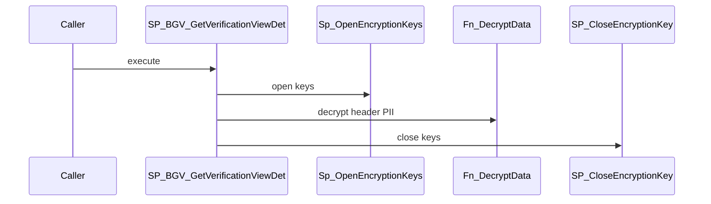
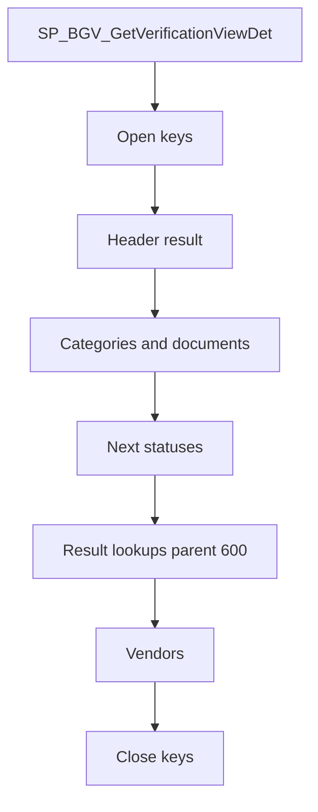

# SP_BGV_GetVerificationViewDet

## What it does

Returns multiple result sets for one verification id: header (decrypted PII, status, vendor, BU), category rows with template/uploaded/report document name lists, next-status choices (children of current status, or the current status alone), verification-result lookups under parent `600`, and active vendors for the request’s employer.

## Parameters

| Name | Direction | What it is for |
|---|---|---|
| `@VerificationId` | in | Request to view |

## Call sequence

## Callers

No other procedure or function calls this object. Application caller: BGV API `bgverificationDAL.ViewBGVRecord`.

## Nested

| Object | Kind | When | Page |
|---|---|---|---|
| `Sp_OpenEncryptionKeys` | procedure | always | [Sp_OpenEncryptionKeys](/docs/database/hrms/Sp_OpenEncryptionKeys) |
| `Fn_DecryptData` | function | header name/email | [Fn_DecryptData](/docs/database/hrms/Fn_DecryptData) |
| `SP_CloseEncryptionKey` | procedure | always | [SP_CloseEncryptionKey](/docs/database/hrms/SP_CloseEncryptionKey) |

## Steps

1. Script is `HRMS-DATABASE/HRMS/STOREPROCEDURE/SP_BGV_GetVerificationViewDet.sql`.
2. Open keys; select header from `TBGVVerificationRequest`.
3. Select categories joined to `TBGVRequestCategory` with document name aggregations from `TDocuments` / `TDocumentGroup` / `TBGVDocumentsRequest` / `TBGVVerificationReport`.
4. If current status has child lookups, return those; else return the current status row.
5. Return result lookups where `Lookup_parent_id = 600`.
6. Return active non-deleted vendors for the request employer; close keys.

## Tables

| Table | Read or write |
|---|---|
| `dbo.TBGVVerificationRequest` | read |
| `dbo.TEmployeeInfo` | read |
| `dbo.TBGVStatusLOOKUP` | read |
| `dbo.TBGVCategory` | read |
| `dbo.TBGVRequestCategory` | read |
| `dbo.TDocuments` | read |
| `dbo.TDocumentGroup` | read |
| `dbo.TBGVDocumentsRequest` | read |
| `dbo.TBGVVerificationReport` | read |
| `dbo.TBGVVendor` | read |

## Flow

