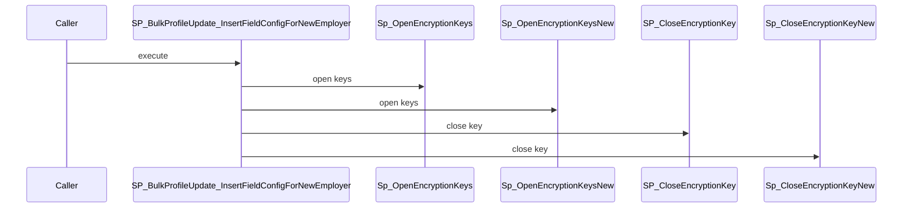
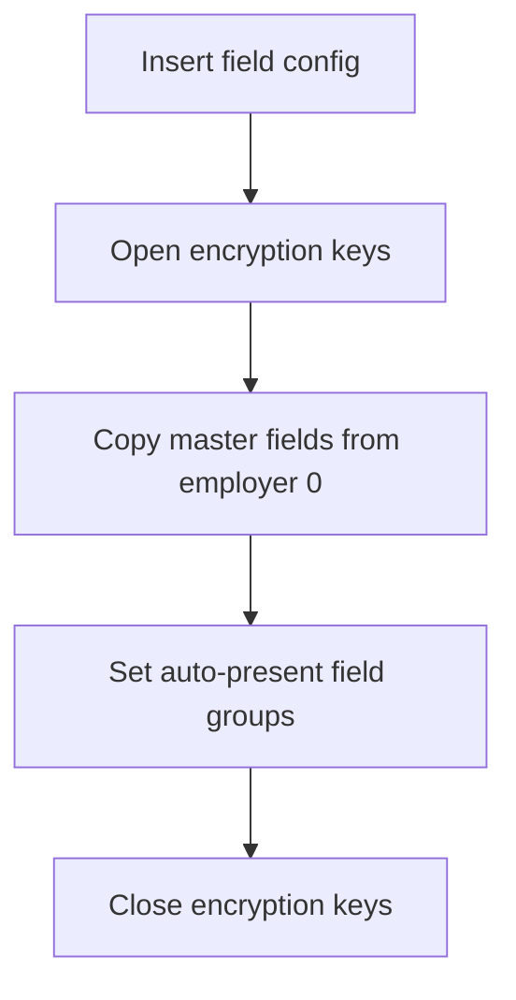

# SP_BulkProfileUpdate_InsertFieldConfigForNewEmployer

## What it does

Copies My Details field configuration for one section from employer 0 onto a new employer. Add Organization calls it once per section with country name INDIA. Encryption keys are opened and closed around the insert. Errors are printed and not rethrown.

## Parameters

| Name | Direction | What it is for |
|---|---|---|
| `@EmployerId` | in | Employer that receives the fields |
| `@SectionName` | in | TEmployeeDetail_Section.Section |
| `@CountryName` | in | Country name. Null is treated as INDIA |

## Call sequence

## Callers

Procedures and functions that call this object.

| Object | Kind | Page |
|---|---|---|
| `SP_AdminORG_AddEmployerDet` | procedure | [SP_AdminORG_AddEmployerDet](/docs/database/hrms/SP_AdminORG_AddEmployerDet) |

## Nested

| Object | Kind | When | Page |
|---|---|---|
| `Sp_OpenEncryptionKeys` | procedure | before the insert | [Sp_OpenEncryptionKeys](/docs/database/hrms/Sp_OpenEncryptionKeys) |
| `Sp_OpenEncryptionKeysNew` | procedure | before the insert | [Sp_OpenEncryptionKeysNew](/docs/database/hrms/Sp_OpenEncryptionKeysNew) |
| `SP_CloseEncryptionKey` | procedure | after the insert | [SP_CloseEncryptionKey](/docs/database/hrms/SP_CloseEncryptionKey) |
| `Sp_CloseEncryptionKeyNew` | procedure | after the insert | [Sp_CloseEncryptionKeyNew](/docs/database/hrms/Sp_CloseEncryptionKeyNew) |

## Steps

1. Resolve SectionID from TEmployeeDetail_Section and CountryID from TCOUNTRY. A null country name uses INDIA.

2. Open both encryption-key procedures.

3. Insert TEmployeeDetail_Fields from TEMPLOYEEDETAIL_FIELDS_MASTER for employer 0, the section, and field entities SYSTEM, SEGMENT, and COUNTRY.

4. Clear field groups on IsAutoPresent and AutoPresentEffectiveFrom, then set those two fields to share one group and field-id list.

5. Close both encryption-key procedures. On error, print ERROR_MESSAGE and leave the catch.

## Tables

| Table | Read or write |
|---|---|
| `TEmployeeDetail_Section` | read |
| `TCOUNTRY` | read |
| `TEmployeeDetail_Fields` | read and write |
| `TEMPLOYEEDETAIL_FIELDS_MASTER` | read |

## Flow

