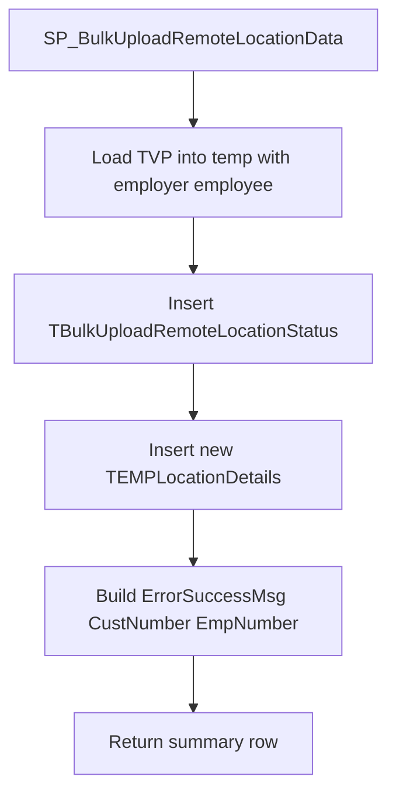

# SP_BulkUploadRemoteLocationData

## What it does

Accepts a bulk remote-location table-valued parameter, resolves employer and employee ids from customer number and employment number, writes per-row process status into `TBulkUploadRemoteLocationStatus`, inserts new non-duplicate fences into `TEMPLocationDetails`, and returns a summary message plus invalid customer / employment number lists for the UI invalid grid.

## Parameters

| Name | Direction | What it is for |
|---|---|---|
| `@tempBulkRemoteData` | in | `UDT_TBulkUploadRemoteLocation` rows from Excel upload |

## Call sequence

Calls no other procedures or functions.

## Callers

No other procedure or function calls this object. Application caller: `RemoteLocationDAL.UploadBulkRemoteLocation` from Employee Remote Location Bulk Import Upload.

## Nested

Calls no other procedures or functions.

## Steps

1. Script is `HRMS-DATABASE/HRMS/STOREPROCEDURE/SP_BulkUploadRemoteLocationData.sql`.
2. Create `#TBulkUploadRemoteLocation` and load rows joined to `TEmployerDetails` / `TEmployeeInfo`, marking in-file duplicate groups by employer, employment number, lat, long.
3. Insert ranked input rows into `TBulkUploadRemoteLocationStatus` with `ProcessStatus` / `Comments` for duplicates, invalid employment numbers, and existing lat/long fences.
4. Insert into `TEMPLocationDetails` from the temp table where employer and employee resolve, lat/long are non-zero, `DuplicateGroup = 1`, and no matching employee lat/long already exists.
5. Build `@CustIdCnt`, `@EmployeeIdCnt`, and `@AddressCnt` from unresolved or zero-coordinate rows.
6. Return `@Msg` as `ErrorSuccessMsg` plus `CustNumber` and `EmpNumber`.

## Tables

| Table | Read or write |
|---|---|
| `@tempBulkRemoteData` (`UDT_TBulkUploadRemoteLocation`) | read |
| `dbo.TEmployerDetails` | read |
| `dbo.TEmployeeInfo` | read |
| `dbo.TEMPLocationDetails` | read and write |
| `dbo.TBulkUploadRemoteLocationStatus` | write |

## Unresolved calls

None.

## Flow

