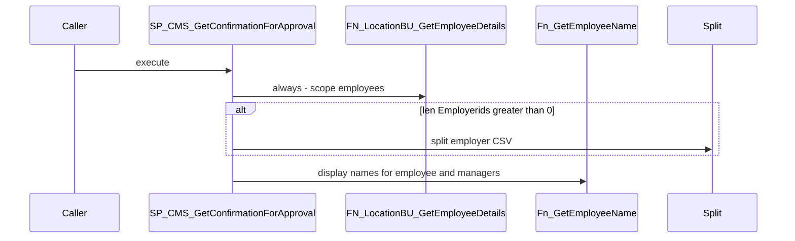
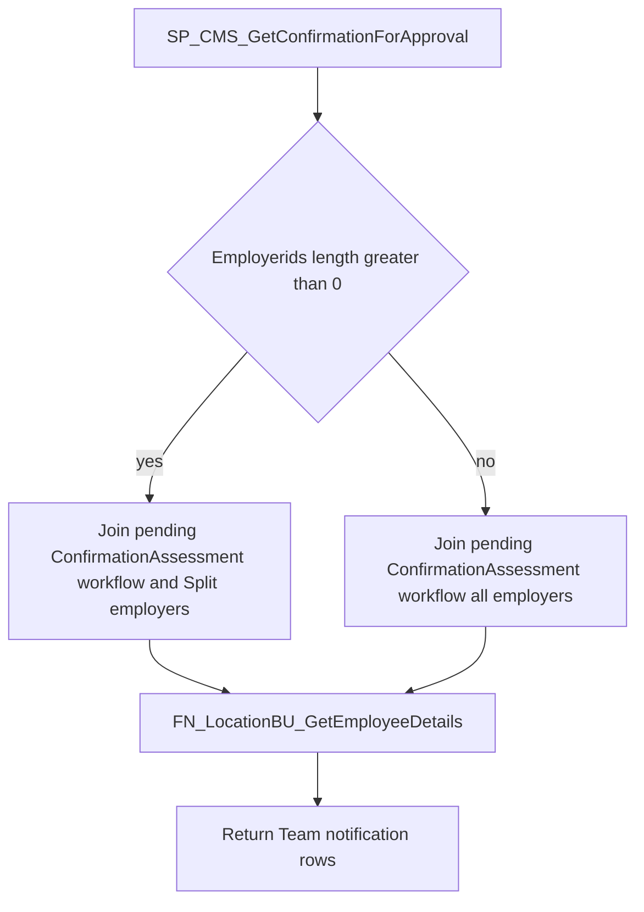

# SP_CMS_GetConfirmationForApproval

## What it does

Returns confirmation assessment rows waiting on a manager. Each row is a `TCMSEmployeeConfirmation` that still has a pending `TRequestWorkflows` line for `RequestType = ConfirmationAssessment`, the employee is active and not yet confirmed (`confirmationdate` is null), and the employee is in the manager's location/BU scope. Optional `@Employerids` narrows to a CSV of employers. Display columns include employee name, managers, pending queue names, organization, and due date.

## Parameters

| Name | Direction | What it is for |
|---|---|---|
| `@ManagerId` | in | Manager whose pending workflow rows are listed |
| `@Employerids` | in | Optional CSV of employer ids; when length &gt; 0, filter `ei.EmployerID` to that set |

## Call sequence

## Callers

No other procedure or function calls this object.

## Nested

| Object | Kind | When | Page |
|---|---|---|---|
| `FN_LocationBU_GetEmployeeDetails` | function | always (`@ManagerId`, null employer) | [FN_LocationBU_GetEmployeeDetails](/docs/database/hrms/FN_LocationBU_GetEmployeeDetails) |
| `Fn_GetEmployeeName` | function | always - employee and manager display names | [Fn_GetEmployeeName](/docs/database/hrms/Fn_GetEmployeeName) |
| `Split` | function | when `len(@Employerids) > 0` | [Split](/docs/database/hrms/Split) |

## Steps

1. If `len(@Employerids) > 0`, run the employer-filtered select; otherwise run the unfiltered branch (`HRMS-DATABASE/HRMS/STOREPROCEDURE/SP_CMS_GetConfirmationForApproval.sql`).

2. Join `TEmployee`, `TEmployeeInfo`, `TPMSEmployerConfiguration`, `TCMSEmployeeConfirmation`, and pending `TRequestWorkflows` (`RequestType = ConfirmationAssessment`, `ApproveStatus = 'P'`) where `rw.managerid = @ManagerId`.

3. Inner-join `FN_LocationBU_GetEmployeeDetails(@ManagerId, null)` so only employees in the manager's location/BU scope appear.

4. Keep rows where `FormStatus` is `Submitted` or `Pending`, `confirmationdate` is null, and `IsActive = 'Y'`. When employer ids are supplied, also require `ei.EmployerID` in `Split(@Employerids, ',')`.

5. Compute `IsDirectToManager` from employer self-assessment settings and/or the confirmation's `IsDirectToManager` flag (branches differ slightly between the two employer-filter paths), set `IsApprover = 'True'`, resolve functional/reporting managers from confirmation vs org chart vs workflow levels, and build `RequestPendingWith` from managers at the max pending approval level.

6. Return the outer select ordered by `EmploymentNumber` descending (case-insensitive).

## Tables

| Table | Read or write |
|---|---|
| `TEmployee` | read |
| `TEmployeeInfo` | read |
| `TPMSEmployerConfiguration` | read |
| `TCMSEmployeeConfirmation` | read |
| `TRequestWorkflows` | read |
| `TTitle` | read |
| `TORGChart` | read |

## Flow

