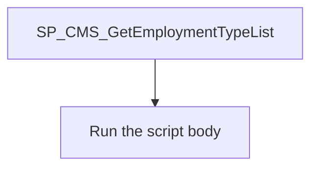

# SP_CMS_GetEmploymentTypeList

## What it does

Returns two lists of employment types for an employer. Non-confirmed types and confirmed types.

## Parameters

| Name | Direction | What it is for |
|---|---|---|
| `@Employerid` | in | Employerid |

## Call sequence

Calls no other procedures or functions.

## Callers

No other procedure or function calls this object.

## Nested

Calls no other procedures or functions.

## Steps

Script: `HRMS-DATABASE/HRMS/STOREPROCEDURE/SP_CMS_GetEmploymentTypeList.sql`.

1. SELECT EmploymentTypeID,

## Tables

| Table | Read or write |
|---|---|
| `TMEmploymentTypes` | read |

## Flow

