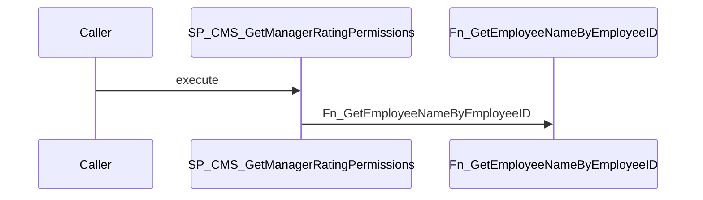
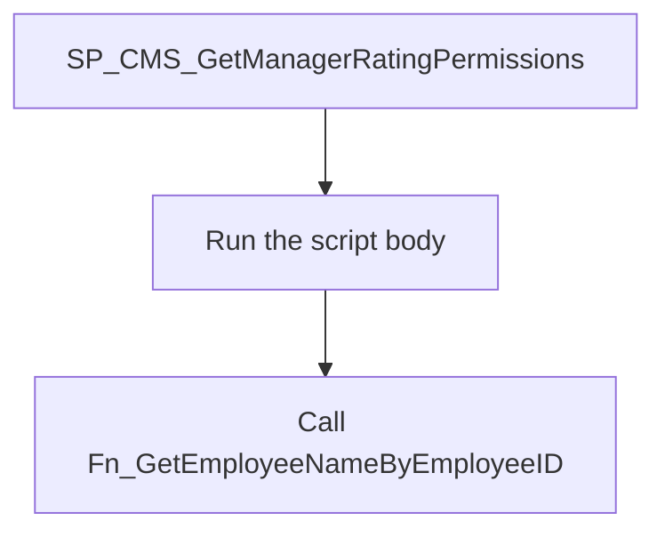

# SP_CMS_GetManagerRatingPermissions

## What it does

Lists employees allowed to enter manager ratings on confirmation, and whether their comments are mandatory. The employer configuration row supplies the comment flag.

## Parameters

| Name | Direction | What it is for |
|---|---|---|
| `@Employerid` | in | Employerid. Default 10 |

## Call sequence

## Callers

No other procedure or function calls this object.

## Nested

| Object | Kind | When | Page |
|---|---|---|---|
| `Fn_GetEmployeeNameByEmployeeID` | function | during execution | [Fn_GetEmployeeNameByEmployeeID](/docs/database/hrms/Fn_GetEmployeeNameByEmployeeID) |

## Steps

Script: `HRMS-DATABASE/HRMS/STOREPROCEDURE/SP_CMS_GetManagerRatingPermissions.sql`.

1. Select permission rows from `TCMSManagerRatingPermissions` joined to `temployeeinfo` where `IsDeleted` is 0 and `Employerid` is `@Employerid`.
2. Resolve each employee name and the modifier name with `Fn_GetEmployeeNameByEmployeeID`.
3. Read `MngrCommentsMandatory` and the employer name from `TPMSEmployerConfiguration` for that employee.

## Tables

| Table | Read or write |
|---|---|
| `TPMSEmployerConfiguration` | read |
| `TCMSManagerRatingPermissions` | read |
| `temployeeinfo` | read |

## Flow

