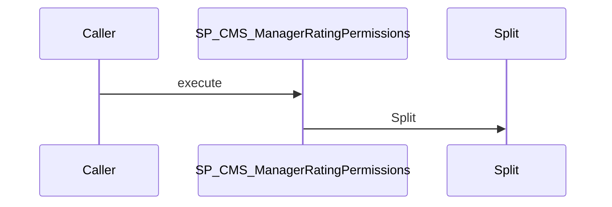
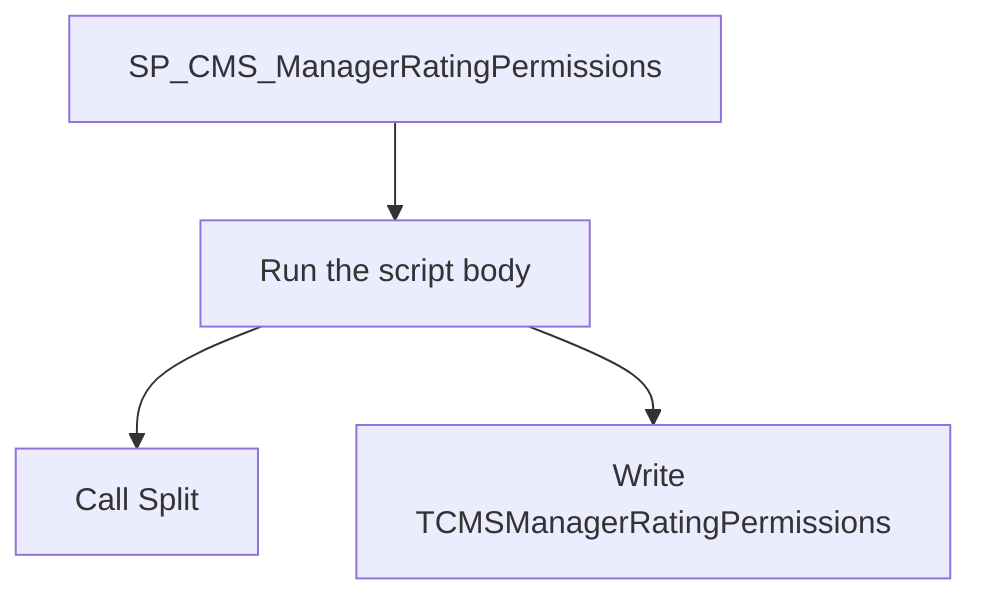

# SP_CMS_ManagerRatingPermissions

## What it does

Grants, updates, or removes manager-rating permission for a list of employees.

## Parameters

| Name | Direction | What it is for |
|---|---|---|
| `@EmployeeIDs` | in | Employee IDs |
| `@Employerid` | in | Employerid |
| `@CreatedBy` | in | Created By |
| `@MngrCommentsMandatory` | in | Mngr Comments Mandatory |
| `@IsDeleted` | in | Is Deleted |
| `@Action` | in | Action |

## Call sequence

## Callers

No other procedure or function calls this object.

## Nested

| Object | Kind | When | Page |
|---|---|---|---|
| `Split` | function | during execution | [Split](/docs/database/hrms/Split) |

## Steps

Script: `HRMS-DATABASE/HRMS/STOREPROCEDURE/SP_CMS_ManagerRatingPermissions.sql`.

1. INSERT INTO @TableEmployeeIDs (EmployeeID)
2. select EmployeeID from @TableEmployeeIDs
3. While @@Fetch_Status = 0
4. if(@tempCount>0)
5. If(@Action ='INS')
6. Insert TCMSManagerRatingPermissions
7. ELSE If(@Action ='UPD')
8. update TCMSManagerRatingPermissions
9. ELSE If(@Action ='DEL')
10. update TCMSManagerRatingPermissions

## Tables

| Table | Read or write |
|---|---|
| `TCMSManagerRatingPermissions` | read/write |
| `TableEmployeeIDsCursor` | read |

## Flow

