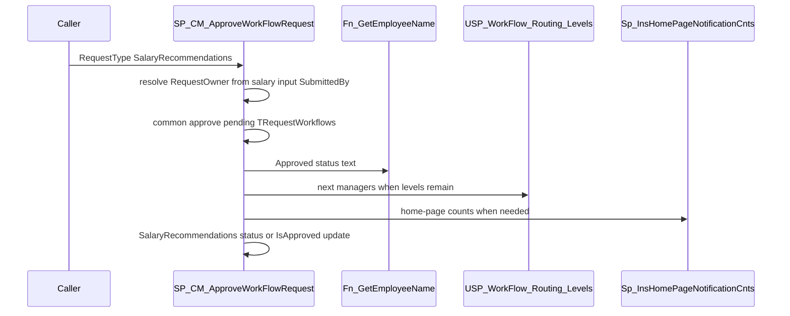
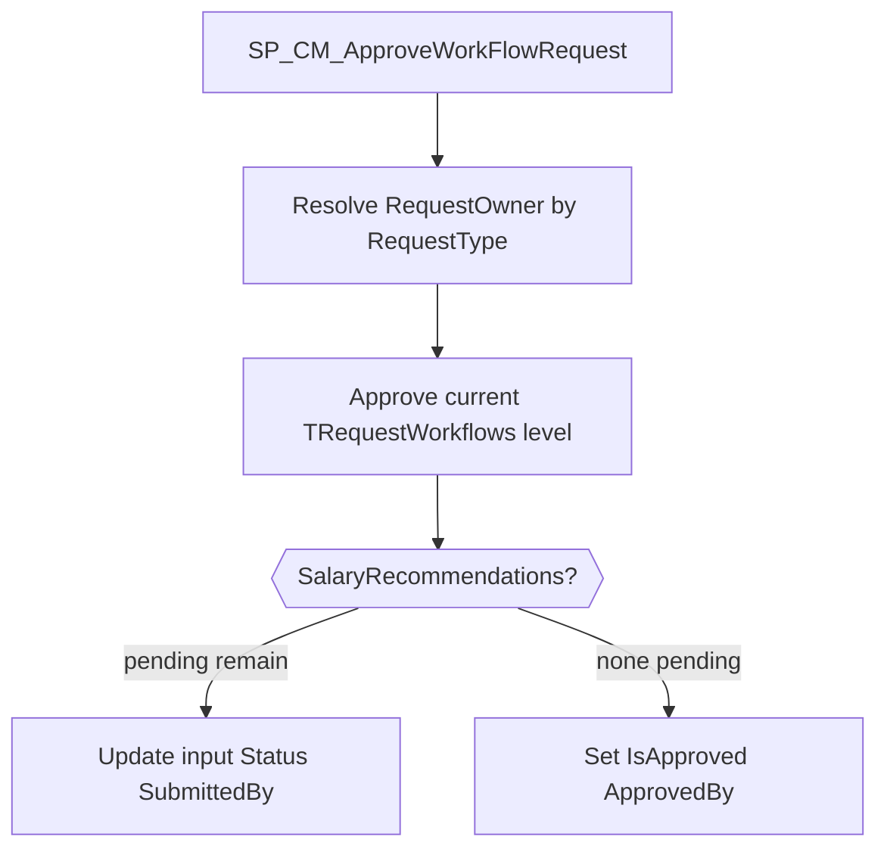

# SP_CM_ApproveWorkFlowRequest

## What it does

Shared workflow approval engine for many `RequestType` values. For **Salary Recommendations** (callers that pass `RequestType = 'SalaryRecommendations'`), `@RequestTransId` is the appraisal cycle id. The procedure resolves `@lv_RequestOwner` from `TPMSSalaryRevInputForEmployeeAssessment.SubmittedBy`, then runs the common approve/routing/email branches. In the SalaryRecommendations-specific status block: if pending `TRequestWorkflows` rows remain, it updates input Status/SubmittedBy/SubmittedOn; otherwise it sets `IsApproved = 1` with ApprovedOn/ApprovedBy. Other request types (leave, recruitment, self-assessment, …) share this procedure body but are outside the Salary Recommendations page path.

## Parameters

| Name | Direction | What it is for |
|---|---|---|
| `@RequestType` | in | Workflow name; Salary Recommendations uses `SalaryRecommendations` |
| `@RequestTransId` | in | For this flow: appraisal cycle id |
| `@EmployeeId` | in | Approving manager (logged-in employee) |
| `@comments` | in | Approval comment |
| `@Employerid` | in | Employer of the request |
| `@confirmationStatus` | in | Optional; other flows |
| `@Noofdays` | in | Optional; other flows |
| `@CandidateMappingId` | in | Optional; recruitment |
| `@ActualReleavingDate` | in | Optional; separation |
| `@AddNoticePeriodLeaves` | in | Optional; separation |
| `@HRComments` | in | Optional; other flows |
| `@IsNewResignation` | in | Optional; separation |
| `@OverTimeDuration` | in | Optional; OT |
| `@RequestDataJson` | in | Optional JSON payload |
| `@SkipEmailNotification` | in | Skip email when 1 |
| `@ApprovedFrom` | in | `Web` / `Mobile` / `WhatsApp` |

## Call sequence

## Callers

Many modules call this procedure. Salary Recommendations React uses `performanceAssessmentDAL.ApproveWorkFlowRequest` with `RequestType = 'SalaryRecommendations'`. Also invoked from other Core API / .NET approve paths across leave, recruitment, assessment, and related flows.

## Nested

Salary Recommendations–relevant nested objects (the full procedure nests many more for other request types):

| Object | Kind | When | Page |
|---|---|---|---|
| `Fn_GetEmployeeName` | function | SalaryRecommendations status text | [Fn_GetEmployeeName](/docs/database/hrms/Fn_GetEmployeeName) |
| `FN_GetEmployeeName_Multi` | function | common approve status strings | [FN_GetEmployeeName_Multi](/docs/database/hrms/FN_GetEmployeeName_Multi) |
| `Fn_GetHomePageNotificationIdByRequestType` | function | notification ids | [Fn_GetHomePageNotificationIdByRequestType](/docs/database/hrms/Fn_GetHomePageNotificationIdByRequestType) |
| `USP_WorkFlow_Routing_Levels` | procedure | next-level managers | [USP_WorkFlow_Routing_Levels](/docs/database/hrms/USP_WorkFlow_Routing_Levels) |
| `Sp_InsHomePageNotificationCnts` | procedure | home-page counters | [Sp_InsHomePageNotificationCnts](/docs/database/hrms/Sp_InsHomePageNotificationCnts) |
| `SP_CM_RejectWorkFlowRequest` | procedure | early reject branch (other paths) | [SP_CM_RejectWorkFlowRequest](/docs/database/hrms/SP_CM_RejectWorkFlowRequest) |
| `FN_CM_GetMgrFromRequestWorkflows` | function | pending manager lookup | [FN_CM_GetMgrFromRequestWorkflows](/docs/database/hrms/FN_CM_GetMgrFromRequestWorkflows) |
| `UFN_FormatDateTimeStandard` | function | comment timestamps | [UFN_FormatDateTimeStandard](/docs/database/hrms/UFN_FormatDateTimeStandard) |

## Steps

1. Script is `HRMS-DATABASE/HRMS/STOREPROCEDURE/SP_CM_ApproveWorkFlowRequest.sql` (large shared body).
2. Resolve request owner by `@RequestType`; for SalaryRecommendations read `SubmittedBy` from `TPMSSalaryRevInputForEmployeeAssessment`.
3. Common approve logic updates `TRequestWorkflows`, notifications, and emails for the current level.
4. SalaryRecommendations branch: if pending workflow rows remain, update Status/Submitted*; else set `IsApproved = 1`.

## Tables

| Table | Read or write |
|---|---|
| `TPMSSalaryRevInputForEmployeeAssessment` | read/write (SalaryRecommendations) |
| `TRequestWorkflows` | read/write |
| `TWorkflowManagement` / `TWorkflowDetails` | read |
| `TEmailNotification` | write (common path) |
| Many other module tables | other `@RequestType` values only |

## Unresolved calls

Dynamic / module-specific nests outside SalaryRecommendations are not expanded on this page.

## Flow

