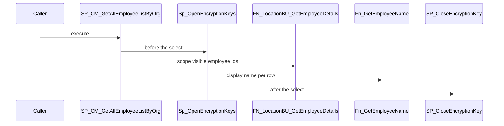
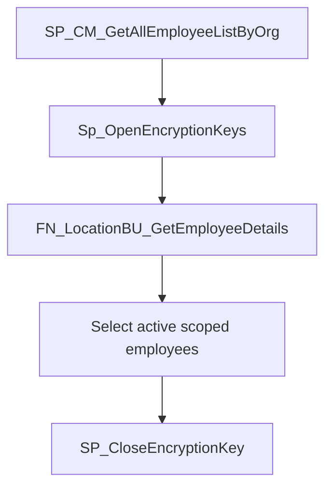

# SP_CM_GetAllEmployeeListByOrg

## What it does

Returns active employees for one employer that the calling employee is allowed to see via location/business-unit rights. Each row includes employee id, a display name built from `Fn_GetEmployeeName` plus employment number, employer id/name, and employment number. Visibility is limited with `FN_LocationBU_GetEmployeeDetails(@EmployeeId, @EmployerId)`.

## Parameters

| Name | Direction | What it is for |
|---|---|---|
| `@EmployerId` | in | Employer whose active employees to list |
| `@EmployeeId` | in | Calling employee used for location/BU scope |

## Call sequence

## Callers

No other procedure or function calls this object. `EmployeeDal.GetAllEmployeeInfoByOrg` executes it from Employee Bulk Update (`EmployeeBulkUpdate.aspx.cs`) and other screens.

## Nested

| Object | Kind | When | Page |
|---|---|---|---|
| `Sp_OpenEncryptionKeys` | procedure | start of the body | [Sp_OpenEncryptionKeys](/docs/database/hrms/Sp_OpenEncryptionKeys) |
| `FN_LocationBU_GetEmployeeDetails` | function | filter employees visible to `@EmployeeId` | [FN_LocationBU_GetEmployeeDetails](/docs/database/hrms/FN_LocationBU_GetEmployeeDetails) |
| `Fn_GetEmployeeName` | function | build the `Name` column | [Fn_GetEmployeeName](/docs/database/hrms/Fn_GetEmployeeName) |
| `SP_CloseEncryptionKey` | procedure | end of the body | [SP_CloseEncryptionKey](/docs/database/hrms/SP_CloseEncryptionKey) |

## Steps

From `HRMS-DATABASE/HRMS/STOREPROCEDURE/SP_CM_GetAllEmployeeListByOrg.sql`:

1. Execute `Sp_OpenEncryptionKeys`.
2. Select active `TEmployee` / `TEmployeeInfo` / `TEmployerDetails` rows for `@EmployerId` where the employee id is in `FN_LocationBU_GetEmployeeDetails(@EmployeeId, @EmployerId)`, formatting `Name` as decrypted name plus employment number.
3. Execute `SP_CloseEncryptionKey`.

## Tables

| Table | Read or write |
|---|---|
| `dbo.TEmployee` | read |
| `dbo.TEmployeeInfo` | read |
| `dbo.TEmployerDetails` | read |

## Flow

