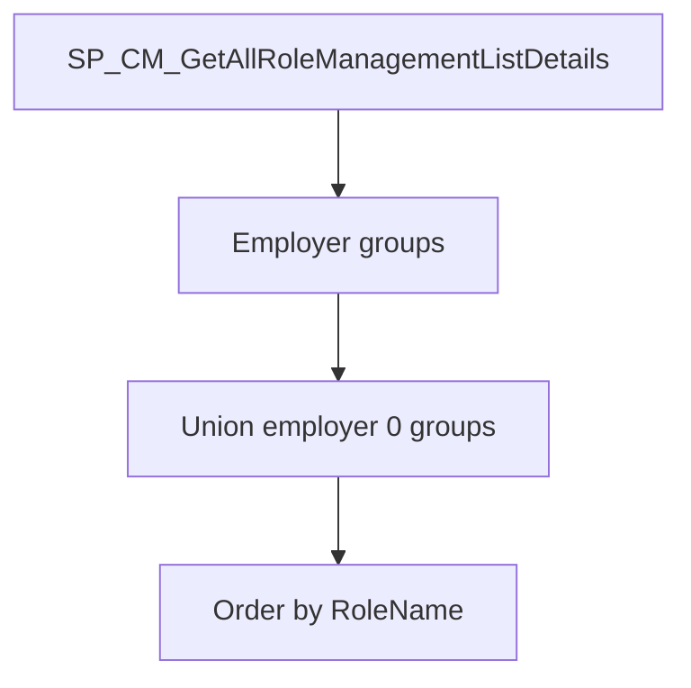

# SP_CM_GetAllRoleManagementListDetails

## What it does

Lists non-deleted workflow groups for the given employer unioned with employer-`0` default groups, including comma-separated location and business-unit ids. Ordered by `RoleName`. Define Workflow's `WorkflowList` enrichment uses this list to expand group nodes.

## Parameters

| Name | Direction | What it is for |
|---|---|---|
| `@Employerid` | in | Organisation |

## Call sequence

Calls no other procedures or functions.

## Callers

No other procedure or function calls this object.

Node `recruitmentDAL.GetRoleManagementList` calls it from `/api/workflow/WorkflowList`.

## Nested

Calls no other procedures or functions.

## Steps

1. Select employer-scoped `TRoleManagement` rows with `IsDelete = 0` and aggregated location/BU ids (`SP_CM_GetAllRoleManagementListDetails.sql`).
2. Union the same shape for `Employerid = 0`.
3. Order by `RoleName`.

## Tables

| Table | Read or write |
|---|---|
| `TRoleManagement` | read |
| `trolelocationmapping` | read |
| `trolebusinessunitmapping` | read |

## Flow

