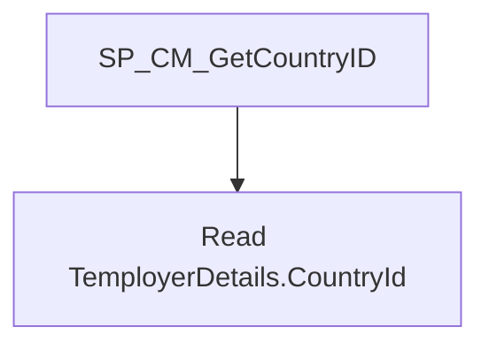

# SP_CM_GetCountryID

## What it does

Returns the country id stored on one employer row.

## Parameters

| Name | Direction | What it is for |
|---|---|---|
| `@Employerid` | in | Employer whose country is read |

## Call sequence

Calls no other procedures or functions.

## Callers

No other procedure or function calls this object.

## Nested

Calls no other procedures or functions.

## Steps

1. Select `CountryId` from `TemployerDetails` for `@EmployerId`.

## Tables

| Table | Read or write |
|---|---|
| `TemployerDetails` | read |

## Flow

