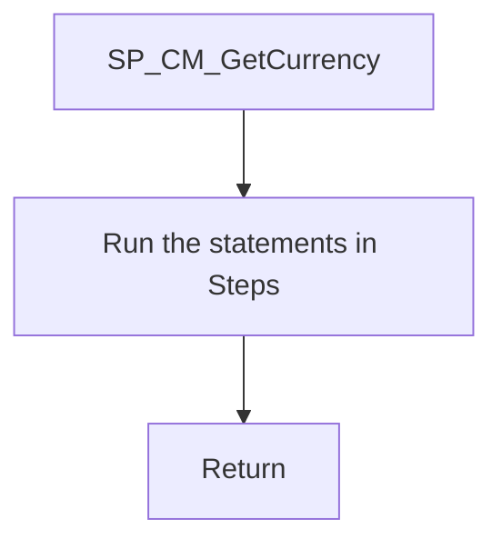

# SP_CM_GetCurrency

## What it does

Returns all rows from TCountry ordered by CURRENCYCODE for currency pickers.

## Parameters

| Name | Direction | What it is for |
|---|---|---|
| — | — | No parameters |

## Call sequence

Calls no other procedures or functions.

## Callers

No other procedure or function calls this object.

## Nested

Calls no other procedures or functions.

## Steps

1. Select all columns from TCountry ordered by CURRENCYCODE.

## Tables

| Table | Read or write |
|---|---|
| `dbo.TCountry` | read |

## Flow

