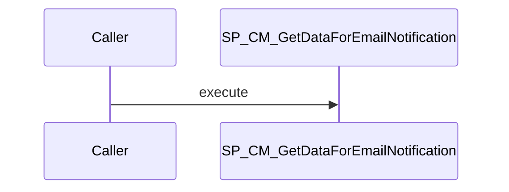
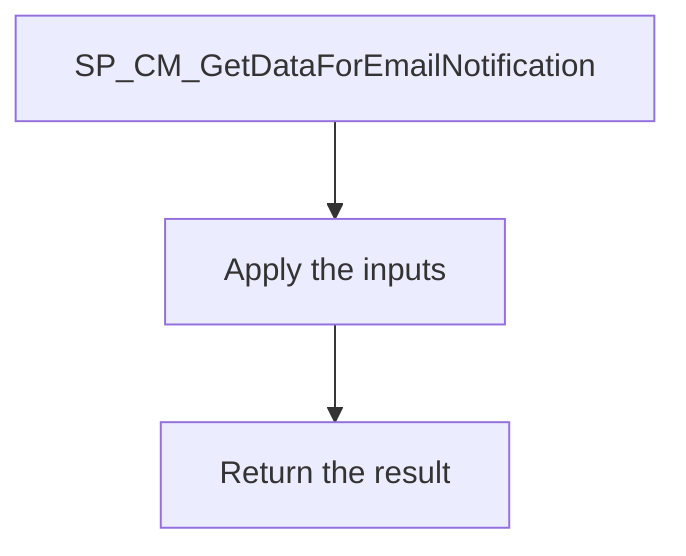

# SP_CM_GetDataForEmailNotification

## What it does

Called from the Home dashboard path. It reads its inputs and returns the result to its caller.

## Parameters

| Name | Direction | What it is for |
|---|---|---|
| `@TemplateName` | in | Input used by this procedure (`Varchar(100)`) |
| `@Transid` | in | Input used by this procedure (`Int`) |
| `@EmployeeId` | in | Employee the Home screen is loading or acting for (`Int`) |
| `@EmployerId` | in | Employer that owns the data (`Int`) |
| `@WorkflowId` | in | Workflow id sent with the sign-off. The banner sends 0 when it has none (`Int`) |
| `@ActionName` | in | Input used by this procedure (`Varchar(100)`) |
| `@CreatedBy` | in | Input used by this procedure (`Int`) |
| `@lv_Approvers` | in | Input used by this procedure (`Varchar(100)`) |
| `@RRSId` | in | Input used by this procedure (`Int`) |
| `@Panel` | in | Input used by this procedure (`Int`) |

## Call sequence

## Callers

| Object | Kind | Page |
|---|---|---|
| `SP_AddAdminChanges` | procedure | [SP_AddAdminChanges](/docs/database/hrms/SP_AddAdminChanges) |
| `SP_AddAdminChanges_DP` | procedure | No page yet |
| `SP_AddCompOffRequest` | procedure | No page yet |
| `SP_AddCompOffRequest_Mobile` | procedure | No page yet |
| `SP_AdminLM_UpdNewLeaveType` | procedure | No page yet |
| `SP_AdminMstr_UpdEmploymentType` | procedure | No page yet |
| `SP_AdminPD_MailToEmployees` | procedure | No page yet |
| `SP_AdminRM_InsDocTemplatesNew` | procedure | No page yet |
| `SP_AdminWM_UpdateRoles` | procedure | No page yet |
| `Sp_Advances_InsAdvanceReqByEmployee` | procedure | No page yet |
| `Sp_Advances_UpdAdvanceReqByEmployee` | procedure | No page yet |
| `SP_Bulk_Create_Activate_Employee` | procedure | No page yet |
| `SP_CM_ApproveAdminChangesRequest` | procedure | No page yet |
| `SP_CM_ApproveWorkFlowRequest_240624` | procedure | No page yet |
| `SP_CM_ApproveWorkFlowRequest_test` | procedure | No page yet |
| `SP_CM_ApproveWorkFlowRequestBKP03052025` | procedure | No page yet |
| `SP_CM_ApproveWorkFlowRequestbkp21032024` | procedure | No page yet |
| `SP_CM_RejectAdminChangesRequest` | procedure | No page yet |
| `SP_CM_RejectWorkFlowRequest` | procedure | No page yet |
| `SP_CM_RejectWorkFlowRequest_240624` | procedure | No page yet |
| `SP_CM_RejectWorkFlowRequestBKP03052025` | procedure | No page yet |
| `SP_CMS_UpdEmpConfirmationRatings` | procedure | No page yet |
| `SP_deleteEmpDocGeneratedDetailsNew` | procedure | No page yet |
| `SP_DeleteRRSDocTemplateByDocIdNew` | procedure | No page yet |
| `SP_DocumentGen_MailToEmp` | procedure | No page yet |
| `SP_EC_UpdateEmployeeOfficialInformation` | procedure | No page yet |
| `SP_EC_UpdateEmployeeOfficialInformation_240624` | procedure | No page yet |
| `SP_ESS_EmailReminder_Scheduler` | procedure | No page yet |
| `SP_ESS_InsertBusinessCardDetails` | procedure | No page yet |
| `SP_ESS_OverDueEmailScheduler` | procedure | No page yet |
| `SP_InsertDocumentAttestation` | procedure | [SP_InsertDocumentAttestation](/docs/database/hrms/SP_InsertDocumentAttestation) |
| `SP_InsertEmpDocGeneratedDetailsNew` | procedure | No page yet |
| `SP_LA_AddAttendanceRegularisationDetails` | procedure | No page yet |
| `SP_LA_AddWorkFromHomeRequestDetails` | procedure | No page yet |
| `SP_LA_InsertLeaveRequestDetails` | procedure | No page yet |
| `SP_LA_InsertLeaveRequestDetails_dp` | procedure | No page yet |
| `SP_LA_InsertOptionalHoliday` | procedure | No page yet |
| `SP_LA_LeaveCancellation` | procedure | No page yet |
| `SP_LA_OptionalHolidayCancellation` | procedure | No page yet |
| `SP_LA_UpdateARPullBack` | procedure | No page yet |
| `SP_LA_UpdateLeavePullBack` | procedure | No page yet |
| `SP_LA_UpdateOptionalHolidayPullBack` | procedure | No page yet |
| `SP_LA_UpdateWFHPullBack` | procedure | No page yet |
| `SP_Mydetails_Enhanced_UpdateEmployeeOfficialInformation` | procedure | No page yet |
| `SP_OD_UpdateODPullBack` | procedure | No page yet |
| `SP_PMS_PullbackSalaryRevForEmployeeAssessment` | procedure | No page yet |
| `SP_PMS_RejectSalaryRevForEmployeeAssessment` | procedure | No page yet |
| `SP_PMS_UpdBulkEmpAppraisalRatings` | procedure | No page yet |
| `SP_PMS_UpdEmpAppraisalRatings` | procedure | No page yet |
| `SP_PMS_UpdSalaryRevForEmployeeAssessment` | procedure | No page yet |
| `SP_PullbackCompOffRequestByEmployee` | procedure | No page yet |
| `SP_PullbackRequest` | procedure | No page yet |
| `Sp_RRS_DeleteDetails` | procedure | No page yet |
| `Sp_RRS_InsertCandidateFeedback` | procedure | No page yet |
| `Sp_RRS_InsertCandidateFeedback_051523` | procedure | No page yet |
| `Sp_RRS_InsertDetails` | procedure | No page yet |
| `Sp_RRS_InsertJobPosting` | procedure | No page yet |
| `Sp_RRS_OfferSendForReview` | procedure | No page yet |
| `Sp_RRS_UpdateCandidate` | procedure | No page yet |
| `Sp_RRS_UpdateInitiateHiring` | procedure | No page yet |
| `Sp_RRS_UpdateInitiateHiringByEmail` | procedure | No page yet |
| `Sp_RRS_UpdateInitiateHiringComments` | procedure | No page yet |
| `SP_RRS_UpdOnHoldCandidateStatus` | procedure | No page yet |
| `SP_SEP_AddResignationDetails` | procedure | No page yet |
| `SP_SEP_DeActivateEmployeeBKP03052025` | procedure | No page yet |
| `SP_SEP_DeActivateEmployeeWithAssets` | procedure | No page yet |
| `SP_SEP_DeactivationReminder_Scheduler` | procedure | No page yet |
| `SP_SEP_ResignationPullback` | procedure | No page yet |
| `USP_Admin_DeleteDocTemplateByDocId` | procedure | No page yet |
| `USP_Admin_InsDocTemplates` | procedure | No page yet |
| `USP_AdminLM_UpdNewLeaveType` | procedure | No page yet |
| `USP_AttendanceOverTime_Process` | procedure | No page yet |
| `USP_Candidate_ExpectedDOJ_Update` | procedure | No page yet |
| `USP_ClaimEventLeave_SaveRequest` | procedure | No page yet |
| `USP_ClaimOT_ProcessPendingRequests` | procedure | No page yet |
| `USP_CompOff_SaveRequest` | procedure | No page yet |
| `Usp_CRB_DeleteBooking` | procedure | No page yet |
| `Usp_CRB_InsertConfbooking` | procedure | No page yet |
| `Usp_CRB_SendApprovalReminders` | procedure | No page yet |
| `Usp_CRB_UpdateBookingStatus` | procedure | No page yet |
| `USP_FNF_Employee_Pullback` | procedure | No page yet |
| `USP_FNF_Employee_SaveUpdate` | procedure | No page yet |
| `USP_LA_InsertLeaveRequestDetails` | procedure | No page yet |
| `USP_LA_LeaveType_Update` | procedure | No page yet |
| `USP_OH_PullbackRequest` | procedure | No page yet |
| `USP_OH_SaveRequest` | procedure | No page yet |
| `USP_OT_Claim_Process` | procedure | No page yet |
| `USP_OT_Deviation_Save` | procedure | No page yet |
| `USP_OT_OTRequest_SaveDeviation` | procedure | No page yet |
| `USP_WFH_PullbackRequest` | procedure | No page yet |
| `USP_WFH_SaveRequest` | procedure | No page yet |

## Nested

This object does not execute another procedure or user-defined function.

## Steps

In `HRMS-DATABASE/HRMS/STOREPROCEDURE/SP_CM_GetDataForEmailNotification.sql`:

1. Return the result set to the caller.

## Tables

No permanent table is read or written. The result comes from parameters, functions, or table variables.

## Flow

