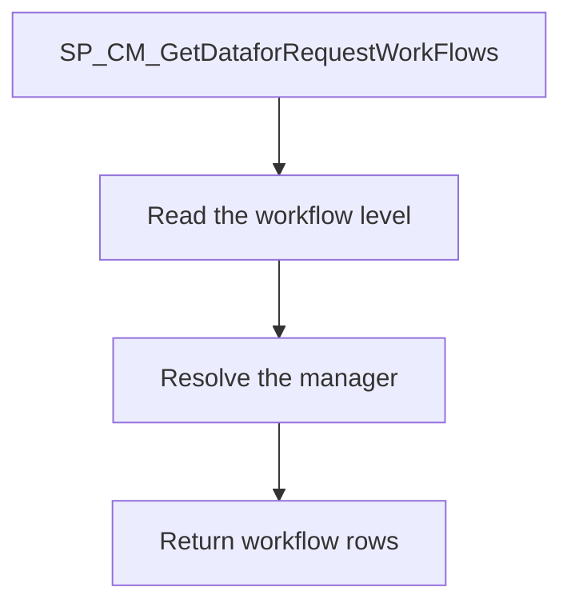

# SP_CM_GetDataforRequestWorkFlows

## What it does

Returns rows shaped for an insert into TRequestWorkflows. It does not insert. It resolves the manager for the workflow routing level from the workflow role, including functional, reporting, hiring, department, and mapped role employees. A candidate mapping id uses the recruitment path.

## Parameters

| Name | Direction | What it is for |
|---|---|---|
| `@Transid` | in | Request transaction id returned on each row |
| `@RequestType` | in | Request type returned on each row |
| `@EmployeeId` | in | Employee used to resolve the manager |
| `@WorkflowId` | in | Workflow |
| `@RoutingLevels` | in | Approval level |
| `@CreatedBy` | in | Created-by value returned on each row |
| `@CandidateMappingID` | in | Optional recruitment candidate mapping |

## Call sequence

Calls no other procedures or functions.

## Callers

Procedures and functions that call this object.

| Object | Kind | Page |
|---|---|---|
| `SP_AddCompOffRequest` | procedure | No page yet |
| `SP_AddCompOffRequest_Mobile` | procedure | No page yet |
| `SP_AdminLM_UpdNewLeaveType` | procedure | No page yet |
| `SP_AdminMstr_UpdEmploymentType` | procedure | No page yet |
| `SP_AdminRM_InsDocTemplatesNew` | procedure | No page yet |
| `SP_AdminWM_UpdateRoles` | procedure | No page yet |
| `SP_ESS_InsertBusinessCardDetails` | procedure | No page yet |
| `SP_InsertEmpDocGeneratedDetailsNew` | procedure | [SP_InsertEmpDocGeneratedDetailsNew](/docs/database/hrms/SP_InsertEmpDocGeneratedDetailsNew) |
| `SP_InsertUpdateTBudget` | procedure | No page yet |
| `SP_LA_AddAttendanceRegularisationDetails` | procedure | No page yet |
| `SP_LA_AddWorkFromHomeRequestDetails` | procedure | No page yet |
| `SP_LA_InsertLeaveRequestDetails` | procedure | No page yet |
| `SP_LA_InsertLeaveRequestDetails_dp` | procedure | No page yet |
| `SP_LA_InsertOptionalHoliday` | procedure | No page yet |
| `SP_LA_LeaveCancellation` | procedure | No page yet |
| `SP_LA_OptionalHolidayCancellation` | procedure | No page yet |
| `SP_LA_UpdateARPullBack` | procedure | No page yet |
| `SP_LA_UpdateLeavePullBack` | procedure | No page yet |
| `SP_LA_UpdateOptionalHolidayPullBack` | procedure | No page yet |
| `SP_LA_UpdateWFHPullBack` | procedure | No page yet |
| `SP_PullbackRequest` | procedure | No page yet |
| `Sp_RRS_InsertCandidateFeedback` | procedure | No page yet |
| `Sp_RRS_InsertCandidateFeedback_051523` | procedure | No page yet |
| `Sp_RRS_InsertDetails` | procedure | No page yet |
| `Sp_RRS_OfferSendForReview` | procedure | No page yet |
| `Sp_RRS_UpdateDetails` | procedure | No page yet |
| `Sp_RRS_UpdateInitiateHiring` | procedure | No page yet |
| `SP_SEP_AddResignationDetails` | procedure | No page yet |
| `SP_SEP_ResignationPullback` | procedure | No page yet |
| `USP_Admin_InsDocTemplates` | procedure | No page yet |
| `USP_AdminLM_UpdNewLeaveType` | procedure | No page yet |
| `USP_AttendanceOverTime_Process` | procedure | No page yet |
| `USP_ClaimEventLeave_Pullback` | procedure | No page yet |
| `USP_ClaimEventLeave_SaveRequest` | procedure | No page yet |
| `USP_ClaimLocum_PullBack` | procedure | No page yet |
| `USP_ClaimLocum_SaveUpdate` | procedure | No page yet |
| `USP_ClaimOT_ProcessPendingRequests` | procedure | No page yet |
| `USP_ClaimOT_SaveUpdate` | procedure | No page yet |
| `USP_ClaimPH_PullBack` | procedure | No page yet |
| `USP_ClaimPH_SaveUpdate` | procedure | No page yet |
| `USP_CompOff_SaveRequest` | procedure | No page yet |
| `USP_FNF_Employee_SaveUpdate` | procedure | No page yet |
| `USP_LA_InsertLeaveRequestDetails` | procedure | No page yet |
| `USP_LA_LeaveType_Update` | procedure | No page yet |
| `USP_LE_Encashment_Save` | procedure | No page yet |
| `USP_OH_PullbackRequest` | procedure | No page yet |
| `USP_OH_SaveRequest` | procedure | No page yet |
| `USP_OT_Claim_Manual` | procedure | No page yet |
| `USP_OT_Claim_Process` | procedure | No page yet |
| `USP_OT_Deviation_Save` | procedure | No page yet |
| `USP_OT_OTRequest_SaveDeviation` | procedure | No page yet |
| `USP_OT_OTRequest_SaveUpdate` | procedure | No page yet |
| `USP_OT_Planned_SaveUpdate` | procedure | No page yet |
| `USP_WFH_PullbackRequest` | procedure | No page yet |
| `USP_WFH_SaveRequest` | procedure | No page yet |

## Nested

Calls no other procedures or functions.

## Steps

1. Read `TWorkflowDetails` for the workflow and routing level (`SP_CM_GetDataforRequestWorkFlows.sql`).
2. When `@CandidateMappingID` is set, resolve the manager from recruitment tables. Otherwise resolve it from employee, org chart, business head, or role mapping.
3. Return one result set with the columns an insert into `TRequestWorkflows` expects.

## Tables

| Table | Read or write |
|---|---|
| `dbo.TWorkflowDetails` | read |
| `dbo.TEmployeeInfo` | read |
| `dbo.TOrgChart` | read |
| `dbo.TRRSDetails` | read |
| `dbo.TRRSCandidateMapping` | read |
| `dbo.trecruiter` | read |
| `dbo.TEmployeeOrgBusinessHead` | read |
| `dbo.tRoleEmployeeMapping` | read |
| `dbo.tRoleBusinessUnitMapping` | read |
| `dbo.tRoleLocationMapping` | read |

## Flow

