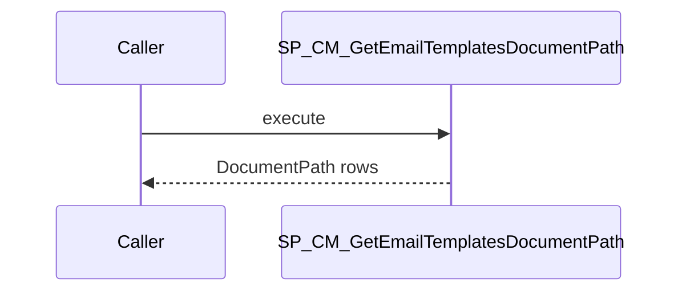
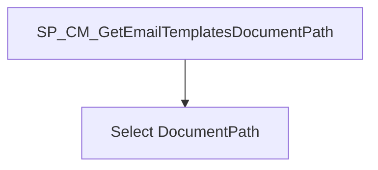

# SP_CM_GetEmailTemplatesDocumentPath

## What it does

Returns `DocumentPath` from `TDocumentPaths` for a given `DocumentType`. HRMS Licenses calls it with type `HRMSLicense` to resolve the upload base folder.

## Parameters

| Name | Direction | What it is for |
|---|---|---|
| `@DocumentType` | in | Path key, e.g. `HRMSLicense` |

## Call sequence

## Callers

No other procedure calls this object. Shared by several features via `dashBoardDAL.GetDocumentPath`. HRMS Licenses uses document type `HRMSLicense`.

## Nested

None.

## Steps

1. Select `DocumentPath` from `TDocumentPaths` where `DocumentType = @DocumentType`.

## Tables

| Table | Read or write |
|---|---|
| `dbo.TDocumentPaths` | read |

## Unresolved calls

None.

## Flow

