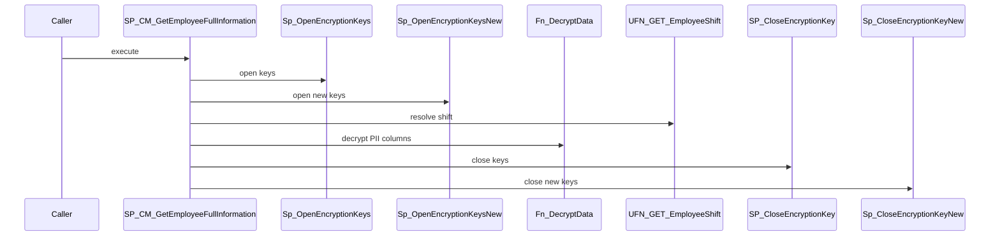
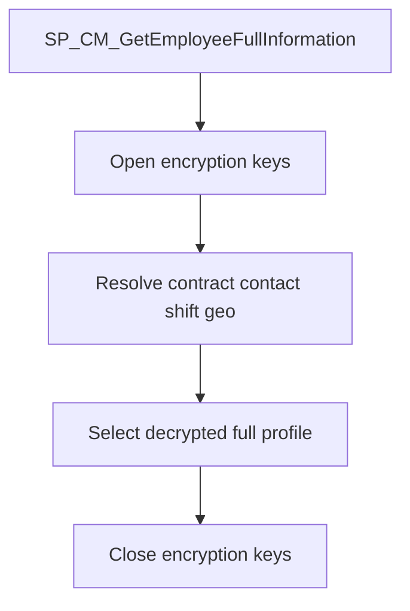

# SP_CM_GetEmployeeFullInformation

## What it does

Returns one wide employee profile row for `@EmployeeID`: decrypted personal fields, employment/org attributes, contact, bank/shift/geo flags, and related lookup names. Used by BGV to fill post-employment person details after an employee is selected. The inventoried script begins with `USE [HRM-CL-Prod]` / `DROP PROCEDURE` before `CREATE`; runtime behaviour is the `CREATE` body.

## Parameters

| Name | Direction | What it is for |
|---|---|---|
| `@EmployeeID` | in | Employee to load |

## Call sequence

## Callers

| Object | Kind | Page |
|---|---|---|
| `USP_CM_GetEmployeeInformation` | procedure | No page yet |

Application caller: BGV API `employeeDAL.GetEmployeeFullInformation`.

## Nested

| Object | Kind | When | Page |
|---|---|---|---|
| `Sp_OpenEncryptionKeys` | procedure | always | [Sp_OpenEncryptionKeys](/docs/database/hrms/Sp_OpenEncryptionKeys) |
| `Sp_OpenEncryptionKeysNew` | procedure | always | [Sp_OpenEncryptionKeysNew](/docs/database/hrms/Sp_OpenEncryptionKeysNew) |
| `Fn_DecryptData` | function | name, DOB, tax id, middle name, and other encrypted columns | [Fn_DecryptData](/docs/database/hrms/Fn_DecryptData) |
| `UFN_GET_EmployeeShift` | function | shift resolution | [UFN_GET_EmployeeShift](/docs/database/hrms/UFN_GET_EmployeeShift) |
| `SP_CloseEncryptionKey` | procedure | always | [SP_CloseEncryptionKey](/docs/database/hrms/SP_CloseEncryptionKey) |
| `Sp_CloseEncryptionKeyNew` | procedure | always | [SP_CloseEncryptionKeyNew](/docs/database/hrms/SP_CloseEncryptionKeyNew) |

## Steps

1. Script is `HRMS-DATABASE/HRMS/STOREPROCEDURE/SP_CM_GetEmployeeFullInformation.sql`.
2. `READ UNCOMMITTED`; open both encryption key helpers.
3. Resolve active contract end date, cross-reporting flag, latest contact detail, shift, geo-fencing flag.
4. Select decrypted and joined employment profile columns from `TEmployee`, `TEmployeeInfo`, and related masters.
5. Close both encryption key helpers.

## Tables

| Table | Read or write |
|---|---|
| `dbo.TEmployee` | read |
| `dbo.TEmployeeInfo` | read |
| `dbo.TEmployeeEmploymentType` | read |
| `dbo.TEmployerDetails` | read |
| `dbo.TEmployeeContactDetails` | read |
| `dbo.TSHIFTMASTER` | read |
| `dbo.TEMPLocationDetails` | read |
| Additional lookup/employment tables joined in the SELECT | read |

## Flow

