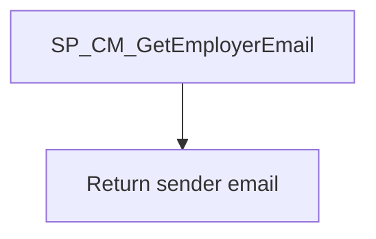

# SP_CM_GetEmployerEmail

## What it does

Returns the employer notification sender email from TEmployerDetails.

## Parameters

| Name | Direction | What it is for |
|---|---|---|
| `@EmployerId` | in | Employer |

## Call sequence

Calls no other procedures or functions.

## Callers

Procedures and functions that call this object.

| Object | Kind | Page |
|---|---|---|
| `SP_RRS_UpdateCommentOfReqForInformation` | procedure | No page yet |

## Nested

Calls no other procedures or functions.

## Steps

1. Select `NotificationSenderEmail` from `TEmployerDetails` for `@EmployerId` (`SP_CM_GetEmployerEmail.sql`).

## Tables

| Table | Read or write |
|---|---|
| `dbo.TEmployerDetails` | read |

## Flow

