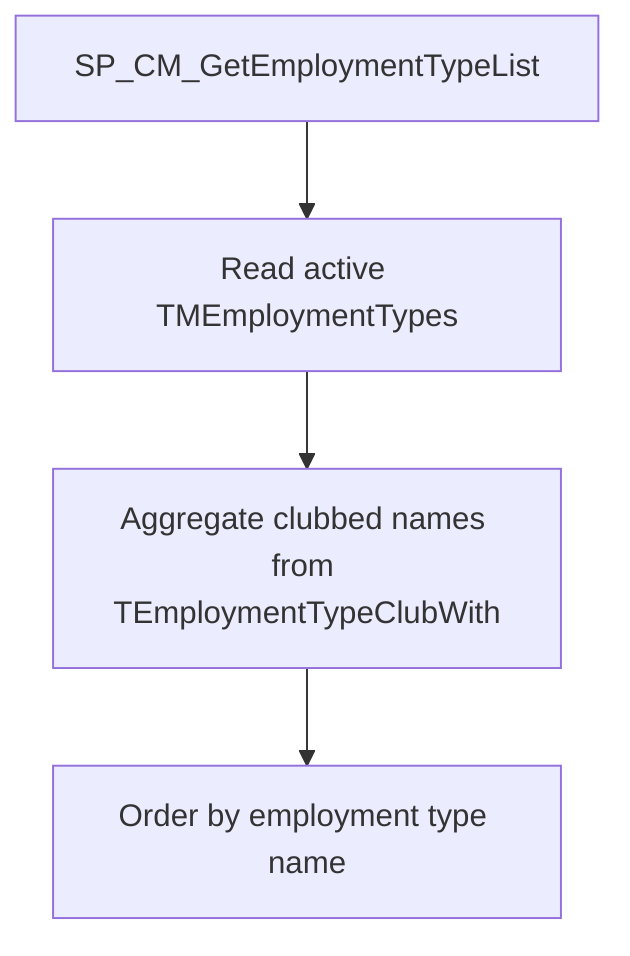

# SP_CM_GetEmploymentTypeList

## What it does

Returns the active employment types for one employer, with a comma-separated list of the other active types they are clubbed with. Policy Documents Setup binds `EmploymentTypeID` and `EmploymentType` to the employment-type exclusion list and does not show the clubbed names. The script has no header comment.

`EmployerDal.GetEmploymentTypeList` calls this.

## Parameters

| Name | Direction | What it is for |
|---|---|---|
| `@Employerid` | in | Employer whose employment types are listed. The parameter is `@Employerid`. The clubbed-type filter compares `@EmployerId`. |

## Call sequence

Calls no other procedures or functions. `STRING_AGG` is a built-in.

## Callers

No other procedure or function calls this object. `EmployerDal.GetEmploymentTypeList` executes it. Policy Documents Setup uses the list for the employment-type exclusion.

## Nested

Calls no other procedures or functions.

## Steps

1. In `HRMS-DATABASE/HRMS/STOREPROCEDURE/SP_CM_GetEmploymentTypeList.sql`, select from `TMEmploymentTypes` where `IsActive` is 1 and `Employerid` is `@Employerid`.
2. For each type, `Restrictions` is `STRING_AGG` of the names of the types it is clubbed with. `TEmploymentTypeClubWith.EmploymentTypeId` matches the outer type, and `EmploymentTypeClubWithId` matches the clubbed `TMEmploymentTypes` row. Only active clubbed types for the same employer are included. A type with no clubbed rows still returns, and `Restrictions` is null, because the join is a left join.
3. Return the type id, name, active flag, prefix, audit columns, confirmation flag, probation months, notice days and type, retirement age, end-of-contract flag, and reminder days.
4. Group by those columns and order by `EmploymentType` ascending.

`TMEmploymentTypes` declares a primary key on `EmploymentTypeID` and no foreign key of its own. `TEmployeeInfo.EmploymentTypeID` does reference it. `TEmploymentTypeClubWith` declares no foreign key. The insert and update procedures compare the selected ids with `TEmployeeInfo.EmploymentTypeID`.

## Tables

| Table | Read or write |
|---|---|
| `dbo.TMEmploymentTypes` | read |
| `dbo.TEmploymentTypeClubWith` | read |

## Flow

