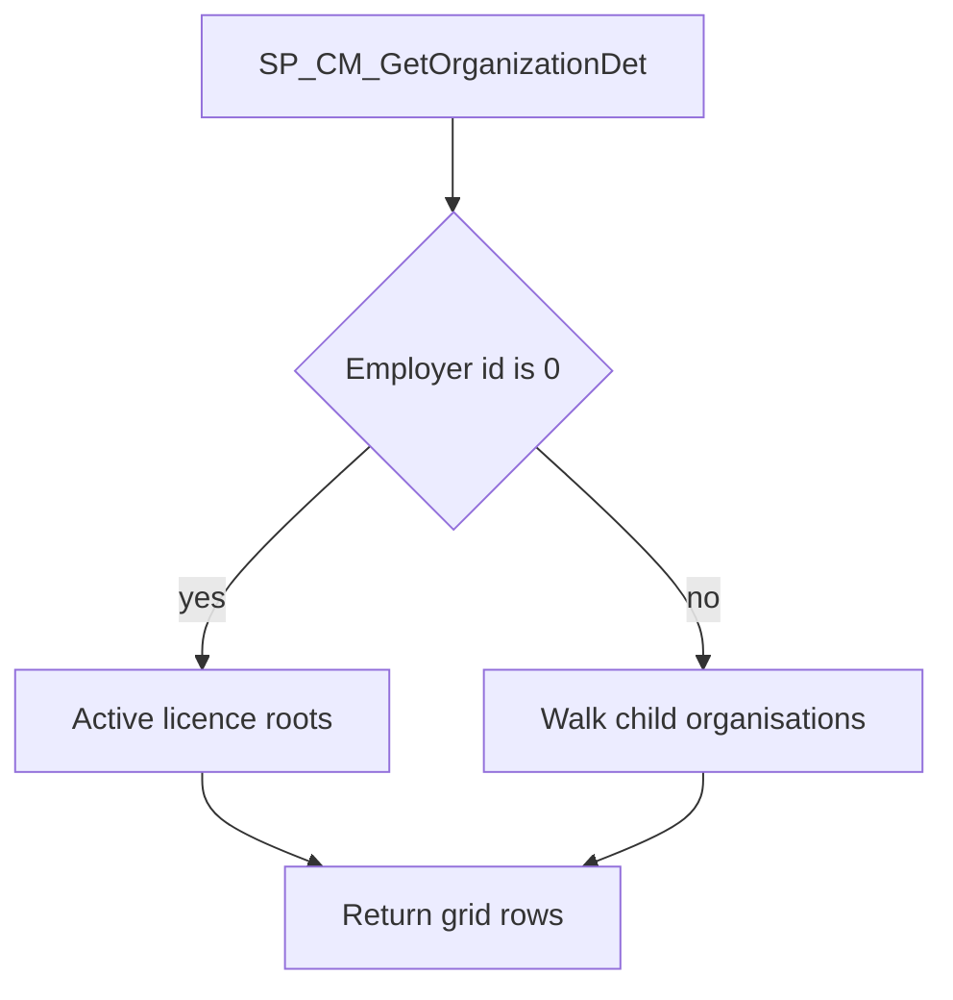

# SP_CM_GetOrganizationDet

## What it does

Returns the organisation grid. Employer id 0 lists every active, not-deleted employer whose root holds an active licence. Any other id lists that employer and its non-deleted descendants.

## Parameters

| Name | Direction | What it is for |
|---|---|---|
| `@Employerid` | in | 0 for the licensed estate, otherwise the root of the tree to list |

## Call sequence

Calls no other procedures or functions.

## Callers

Procedures and functions that call this object.

No other procedure or function calls this object.

## Nested

Calls no other procedures or functions.

## Steps

1. When @Employerid is 0, collect employer ids whose RootEmployerId matches an Active TLicence, then select active, not-deleted TEmployerDetails rows in that set, with parent custid and parent name.

2. Otherwise walk ParentEmployerid downward from @Employerid through non-deleted children and return those TEmployerDetails rows.

3. EffectiveDate in the result is GETDATE minus 365 days. The previous EffectiveDate column is commented out.

## Tables

| Table | Read or write |
|---|---|
| `TLicence` | read |
| `TEmployerDetails` | read |

## Flow

