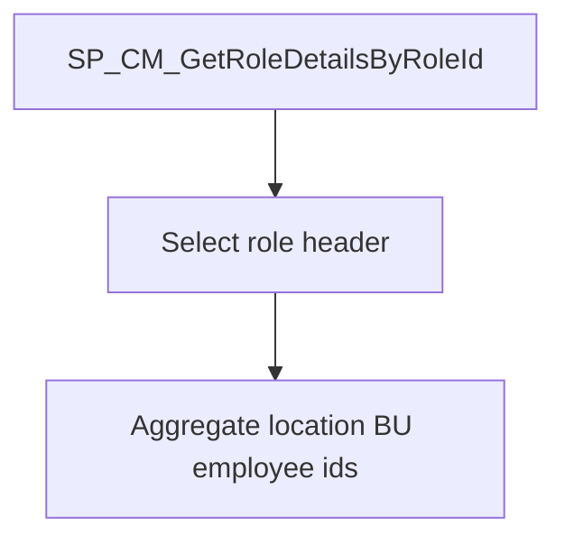

# SP_CM_GetRoleDetailsByRoleId

## What it does

Returns one non-deleted workflow group by `RoleId`, including comma-separated location, business-unit, and employee ids from the mapping tables. Define Workflow uses it to show which people sit under a group node.

## Parameters

| Name | Direction | What it is for |
|---|---|---|
| `@RoleId` | in | Workflow group id |

## Call sequence

Calls no other procedures or functions.

## Callers

No other procedure or function calls this object.

Node `recruitmentDAL.GetRoleDetailsByRoleId` calls it from the Define Workflow group-member load.

## Nested

Calls no other procedures or functions.

## Steps

1. Select the matching `TRoleManagement` row with `IsDelete = 0` (`SP_CM_GetRoleDetailsByRoleId.sql`).
2. Aggregate location, business-unit, and employee ids from the three mapping tables as comma-separated strings.

## Tables

| Table | Read or write |
|---|---|
| `TRoleManagement` | read |
| `trolelocationmapping` | read |
| `trolebusinessunitmapping` | read |
| `troleemployeemapping` | read |

## Flow

