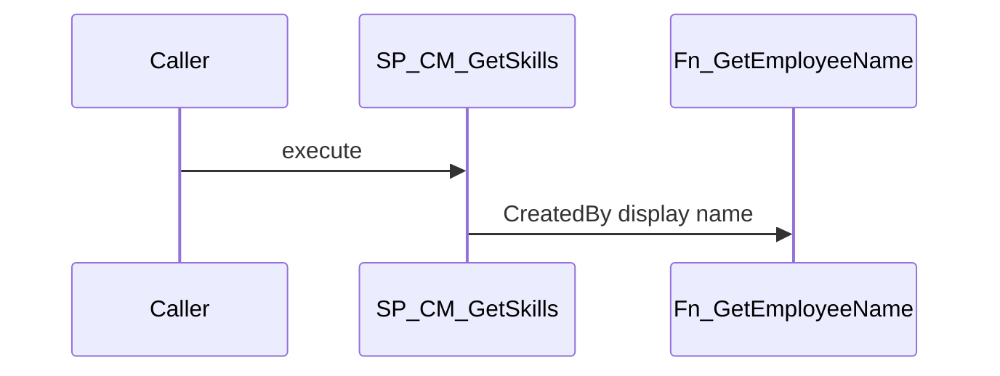
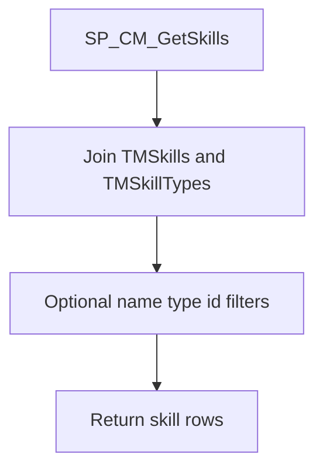

# SP_CM_GetSkills

## What it does

Lists skills for an employer from `TMSkills`, optionally filtered by skill name prefix, type, or skill id, with type metadata from `TMSkillTypes`. Used by Resource Allocation Reports to populate the skill multi-select.

## Parameters

| Name | Direction | What it is for |
|---|---|---|
| `@Employerid` | in | Employer scope |
| `@SkillName` | in | Optional name prefix `LIKE` |
| `@TypeID` | in | Optional skill type filter |
| `@SkillID` | in | Optional single skill id |

## Call sequence

## Callers

No other procedure or function in `HRMS` inventory was traced as a nested caller for this page. Application caller: `employeeDAL.GetEmployeeSkills` → `employeeController.GetEmployeeSkills` from [Reports](/docs/guides/resource-allocation/reports) (RA API `core` connection).

## Nested

| Object | Kind | When | Page |
|---|---|---|---|
| `Fn_GetEmployeeName` | function | `CreatedBy` column | [Fn_GetEmployeeName](/docs/database/hrms/Fn_GetEmployeeName) |

## Steps

1. Script is `HRMS-DATABASE/HRMS/STOREPROCEDURE/SP_CM_GetSkills.sql`.
2. Select skill id/name/keywords/type from `TMSkills` left-joined to `TMSkillTypes`.
3. Apply optional name/type/id filters; order by `SkillName`.

## Tables

| Table | Read or write |
|---|---|
| `dbo.TMSkills` | read |
| `dbo.TMSkillTypes` | read |

## Unresolved calls

None.

## Flow

