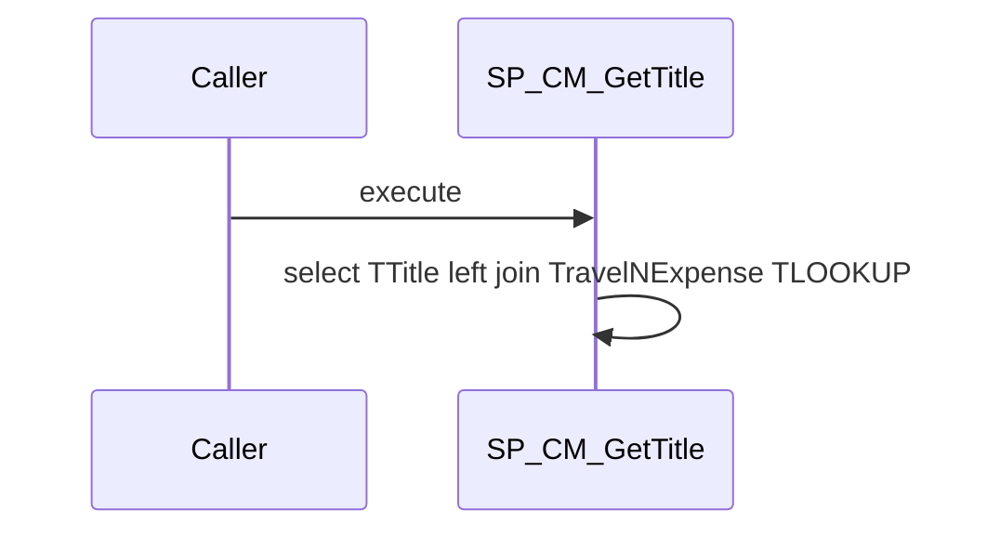
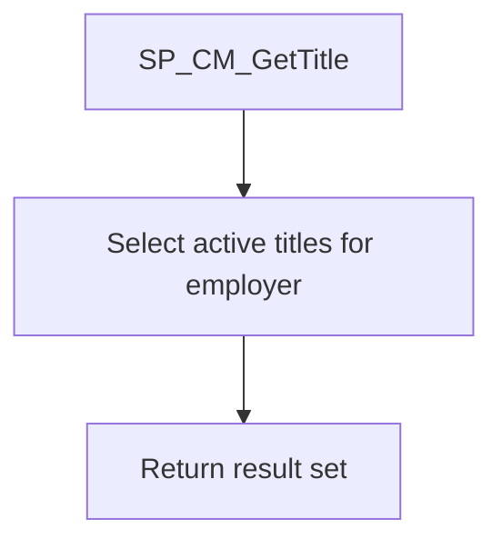

# SP_CM_GetTitle

## What it does

Returns active designation / title rows for one employer from `TTitle`, ordered by title text. Each row includes id, title, description, active flag, and designation level text joined from `TravelNExpense.dbo.TLOOKUP` on `DesignationLevel`.

## Parameters

| Name | Direction | What it is for |
|---|---|---|
| `@Employerid` | in | Employer whose active titles to return |

## Call sequence

Calls no other procedures or functions in the HRMS database.

## Callers

Many dashboard and GlobalFilter procedures execute this object (for example `Sp_Dashboard_CardChartInformation`, `SP_EmployeeInformation_Designation_GlobalFilter`, and other `*_GlobalFilter` scripts under `STOREPROCEDURE/`). `CommonDAL.GetTitleList` also executes it from Employee Bulk Update (`EmployeeBulkUpdate.aspx.cs`).

| Object | Kind | Page |
|---|---|---|
| `Sp_Dashboard_CardChartInformation` | procedure | No page yet |
| `SP_EmployeeInformation_Designation_GlobalFilter` | procedure | No page yet |

## Nested

Calls no other procedures or functions.

## Steps

From `HRMS-DATABASE/HRMS/STOREPROCEDURE/SP_CM_GetTitle.sql`:

1. Select `ID`, `Title`, `TitleDesc`, `IsActive`, and `Lookup_Text` as `DesignationLevel` from `TTitle` left-joined to `[TravelNExpense].[dbo].[TLOOKUP]` on `DesignationLevel = Lookup_ID`.
2. Restrict to `ISActive = 'Y'` and matching `@Employerid`, ordered by `Title`.

## Tables

| Table | Read or write |
|---|---|
| `dbo.TTitle` | read |
| `TravelNExpense.dbo.TLOOKUP` | read |

## Flow

