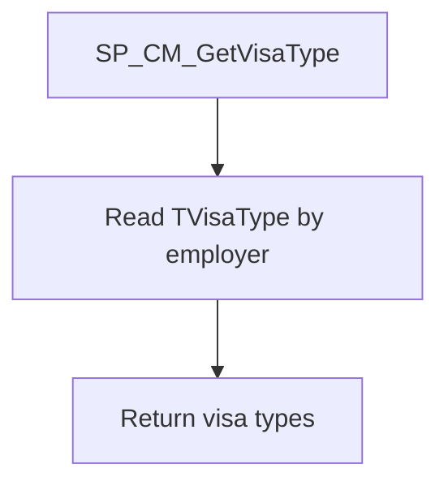

# SP_CM_GetVisaType

## What it does

Returns all visa type rows for an employer from `TVisaType`, ordered by `VisaType`. Used by Resource Allocation Reports to populate the visa multi-select.

## Parameters

| Name | Direction | What it is for |
|---|---|---|
| `@Employerid` | in | Employer scope |

## Call sequence

Calls no other procedures or functions.

## Callers

No other procedure or function in `HRMS` inventory was traced as a nested caller for this page. Application caller: `employeeDAL.GetEmployeeVisaTypes` → `employeeController.GetEmployeeVisaTypes` from [Reports](/docs/guides/resource-allocation/reports) (RA API `core` connection).

## Nested

Calls no other procedures or functions.

## Steps

1. Script is `HRMS-DATABASE/HRMS/STOREPROCEDURE/SP_CM_GetVisaType.sql`.
2. `SELECT * FROM TVisaType WHERE Employerid = @Employerid ORDER BY VisaType`.

## Tables

| Table | Read or write |
|---|---|
| `dbo.TVisaType` | read |

## Unresolved calls

None.

## Flow

