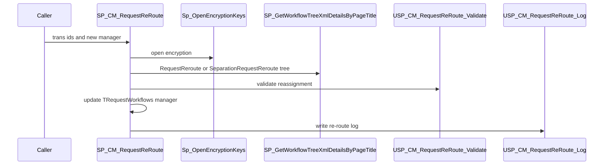
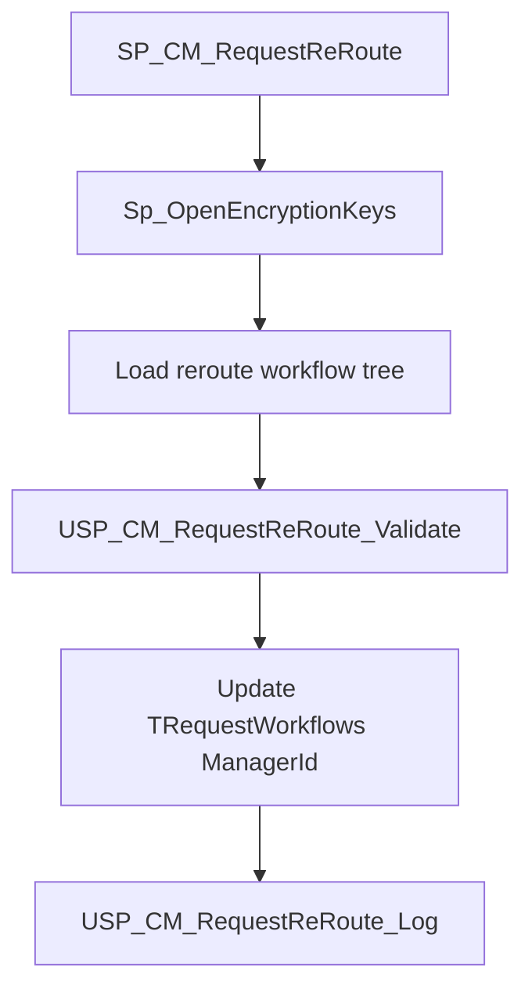

# SP_CM_RequestReRoute

## What it does

Shared reassignment engine used by L&A Tasks **Re-Assign Request**. For each pending `RequestTransId`, validates the new manager, updates `TRequestWorkflows.ManagerId` (and related notification counters), and logs the re-route. Also used by other modules (e.g. separation) with their own page-title workflow trees.

## Parameters

| Name | Direction | What it is for |
|---|---|---|
| `@RequestTransId` | in | One or more request trans ids (varchar list) |
| `@ReRouteEmployeeid` | in | New manager / assignee |
| `@RequestType` | in | Workflow request type |
| `@EmployerId` | in | Employer |
| `@Reason` | in | Reassign reason |
| `@LoggedInEmployeeId` | in | Optional actor |

## Call sequence

## Callers

| Object | Kind | Page |
|---|---|---|
| `ApprovalRejectionDAL.ReRouteSelectedRequest` | app | [L&A Tasks](/docs/guides/leave-and-attendance/l-a-tasks) |

## Nested

| Object | Kind | When | Page |
|---|---|---|---|
| `Sp_OpenEncryptionKeys` | procedure | session encryption | [Sp_OpenEncryptionKeys](/docs/database/hrms/Sp_OpenEncryptionKeys) |
| `SP_GetWorkflowTreeXmlDetailsByPageTitle` | procedure | reroute workflow tree (legacy name) | [SP_GetWorkflowTreeXmlDetailsByPageTitle](/docs/database/hrms/SP_GetWorkflowTreeXmlDetailsByPageTitle) |
| `USP_CM_RequestReRoute_Validate` | procedure | eligibility checks | [USP_CM_RequestReRoute_Validate](/docs/database/hrms/USP_CM_RequestReRoute_Validate) |
| `USP_CM_RequestReRoute_Log` | procedure | audit log | [USP_CM_RequestReRoute_Log](/docs/database/hrms/USP_CM_RequestReRoute_Log) |

## Steps

1. Script is `HRMS-DATABASE/HRMS/STOREPROCEDURE/SP_CM_RequestReRoute.sql`.
2. Open encryption keys; load RequestReroute (or SeparationRequestReroute) workflow tree.
3. Validate each trans id against reassignment rules.
4. Update pending workflow manager / notifications; write re-route log rows.

## Tables

| Table | Read or write |
|---|---|
| `TRequestWorkflows` | read/write |
| Workflow definition tables | read |
| Re-route log table(s) | write via nested log SP |

## Unresolved calls

None for the nested list above.

## Flow

