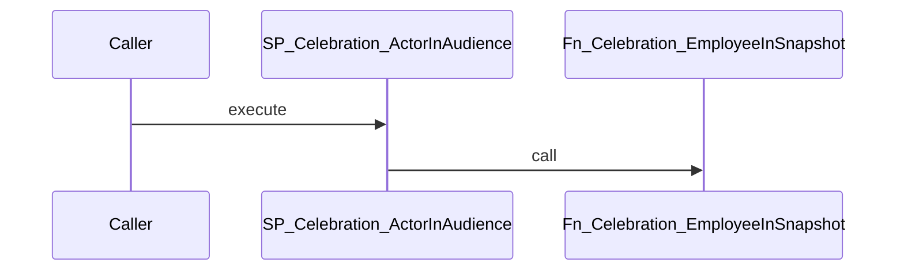
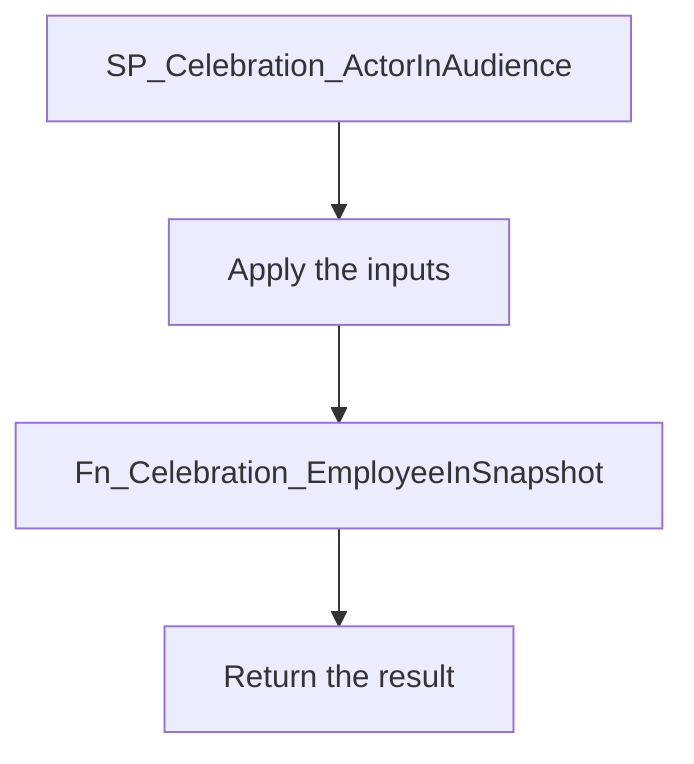

# SP_Celebration_ActorInAudience

## What it does

Returns whether the actor is in the broadcast audience snapshot (used before social writes).

## Parameters

| Name | Direction | What it is for |
|---|---|---|
| `@EmployerId` | in | Input (`INT`) |
| `@BroadcastId` | in | Input (`INT`) |
| `@ActorEmployeeId` | in | Input (`INT`) |

## Call sequence

## Callers

No other procedure or function under STOREPROCEDURE or FUNCTIONS executes this object.

## Nested

| Object | Kind | When | Page |
|---|---|---|---|
| `Fn_Celebration_EmployeeInSnapshot` | function | Called while this object runs | [Fn_Celebration_EmployeeInSnapshot](/docs/database/hrms/Fn_Celebration_EmployeeInSnapshot) |

## Steps

In `HRMS-DATABASE/HRMS/STOREPROCEDURE/161632/SP_Celebration_ActorInAudience.sql`:

1. Returns whether the actor is in the broadcast audience snapshot (used before social writes).

## Tables

| Table | Read or write |
|---|---|
| `TCelebrationBroadcast` | read |
| `TCelebrationBroadcastAudienceSnapshot` | read |
| `TEmployee` | read |
| `TEmployeeInfo` | read |
| `TCelebrationBroadcastAudience` | read |

## Flow

