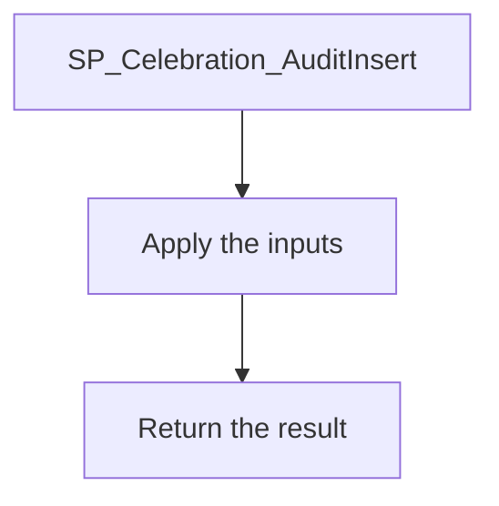

# SP_Celebration_AuditInsert

## What it does

Appends one row to TCelebrationAuditLog inside the caller's transaction.

## Parameters

| Name | Direction | What it is for |
|---|---|---|
| `@EmployerId` | in | Input (`INT`) |
| `@ActorEmployeeId` | in | Input (`INT`) |
| `@ActorType` | in | Input (`VARCHAR(10)`) |
| `@Action` | in | Input (`VARCHAR(50)`) |
| `@EntityType` | in | Input (`VARCHAR(30)`) |
| `@EntityId` | in | Input (`INT`) |
| `@CorrelationId` | in | Input (`NVARCHAR(64)`) |
| `@Message` | in | Input (`NVARCHAR(500)`) |
| `@BeforeJson` | in | Input (`NVARCHAR(MAX)`) |
| `@AfterJson` | in | Input (`NVARCHAR(MAX)`) |

## Call sequence

Calls no other procedures or functions.

## Callers

| Object | Kind | Page |
|---|---|---|
| `SP_Celebration_BroadcastCreate` | procedure | [SP_Celebration_BroadcastCreate](/docs/database/hrms/SP_Celebration_BroadcastCreate) |
| `SP_Celebration_BroadcastDelete` | procedure | [SP_Celebration_BroadcastDelete](/docs/database/hrms/SP_Celebration_BroadcastDelete) |
| `SP_Celebration_BroadcastLimitedEdit` | procedure | [SP_Celebration_BroadcastLimitedEdit](/docs/database/hrms/SP_Celebration_BroadcastLimitedEdit) |
| `SP_Celebration_BroadcastReschedule` | procedure | No page yet |
| `SP_Celebration_BroadcastUpdate` | procedure | [SP_Celebration_BroadcastUpdate](/docs/database/hrms/SP_Celebration_BroadcastUpdate) |
| `SP_Celebration_CategoryUpsertAutoPosting` | procedure | No page yet |
| `SP_Celebration_CategoryUpsertManual` | procedure | No page yet |
| `SP_Celebration_CategoryUpsertMilestone` | procedure | No page yet |
| `SP_Celebration_CommentDelete` | procedure | [SP_Celebration_CommentDelete](/docs/database/hrms/SP_Celebration_CommentDelete) |
| `SP_Celebration_PublishOrCancel` | procedure | No page yet |
| `SP_Celebration_SettingsUpsertAutoPosting` | procedure | No page yet |
| `SP_Celebration_SettingsUpsertBehaviour` | procedure | No page yet |
| `SP_Celebration_TemplateCreate` | procedure | No page yet |
| `SP_Celebration_TemplateDelete` | procedure | No page yet |
| `SP_Celebration_TemplateUpdate` | procedure | No page yet |
| `SP_Celebration_WishSend` | procedure | [SP_Celebration_WishSend](/docs/database/hrms/SP_Celebration_WishSend) |

## Nested

Calls no other procedures or functions.

## Steps

In `HRMS-DATABASE/HRMS/STOREPROCEDURE/161632/SP_Celebration_AuditInsert.sql`:

1. Appends one row to TCelebrationAuditLog inside the caller's transaction.

## Tables

| Table | Read or write |
|---|---|
| `TCelebrationAuditLog` | write |

## Flow

