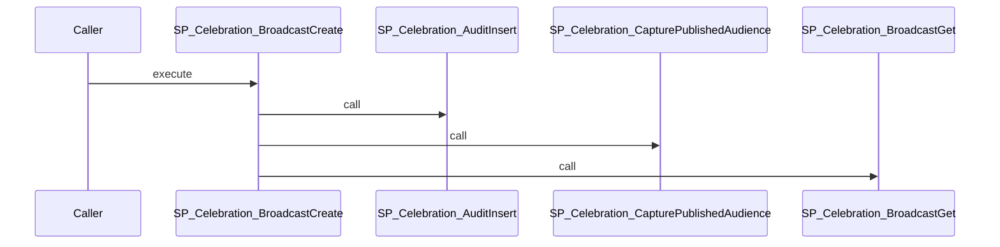
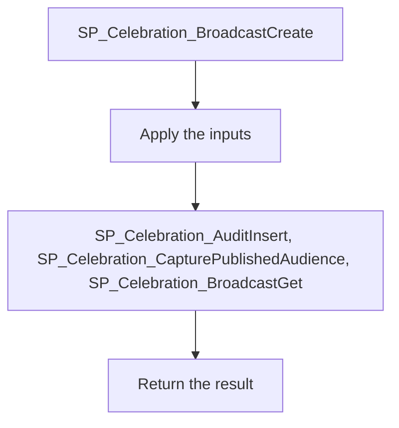

# SP_Celebration_BroadcastCreate

## What it does

Inserts a Draft, Scheduled, Published, or AutoScheduled broadcast, binds files, optionally captures audience, audits, and returns the row.

## Parameters

| Name | Direction | What it is for |
|---|---|---|
| `@EmployerId` | in | Input (`INT`) |
| `@ActorEmployeeId` | in | Input (`INT`) |
| `@CategoryCode` | in | Input (`VARCHAR(30)`) |
| `@EmployeeId` | in | Input (`INT`) |
| `@Status` | in | Input (`VARCHAR(20)`) |
| `@EventDate` | in | Input (`DATE`) |
| `@PublishAt` | in | Input (`DATETIME2`) |
| `@ExpiryDate` | in | Input (`DATETIME2`) |
| `@AllowComments` | in | Input (`BIT`) |
| `@NotifyViaEmail` | in | Input (`BIT`) |
| `@MandatoryRead` | in | Input (`BIT`) |
| `@TemplateSnapshotJson` | in | Input (`NVARCHAR(MAX)`) |
| `@TitleText` | in | Input (`NVARCHAR(400)`) |
| `@AudienceJson` | in | Input (`NVARCHAR(MAX)`) |
| `@AttachmentFileIds` | in | Input (`NVARCHAR(MAX)`) |
| `@AvatarFileId` | in | Input (`INT`) |
| `@CreatedByType` | in | Input (`VARCHAR(10)`) |

## Call sequence

## Callers

No other procedure or function under STOREPROCEDURE or FUNCTIONS executes this object.

## Nested

| Object | Kind | When | Page |
|---|---|---|---|
| `SP_Celebration_AuditInsert` | procedure | Called while this object runs | [SP_Celebration_AuditInsert](/docs/database/hrms/SP_Celebration_AuditInsert) |
| `SP_Celebration_CapturePublishedAudience` | procedure | Called while this object runs | [SP_Celebration_CapturePublishedAudience](/docs/database/hrms/SP_Celebration_CapturePublishedAudience) |
| `SP_Celebration_BroadcastGet` | procedure | Called while this object runs | [SP_Celebration_BroadcastGet](/docs/database/hrms/SP_Celebration_BroadcastGet) |

## Steps

In `HRMS-DATABASE/HRMS/STOREPROCEDURE/161632/SP_Celebration_BroadcastCreate.sql`:

1. Inserts a Draft, Scheduled, Published, or AutoScheduled broadcast, binds files, optionally captures audience, audits, and returns the row.
2. May return a validation `ResultCode` / `Message` result set instead of mutating when inputs fail checks.
4. Calls `SP_Celebration_AuditInsert` after a successful mutation.
5. Calls `SP_Celebration_CapturePublishedAudience` when the broadcast is published.
6. Reloads the broadcast via `SP_Celebration_BroadcastGet` before returning.

## Tables

| Table | Read or write |
|---|---|
| `TEmployee` | read |
| `TCelebrationBroadcast` | write |
| `TCelebrationBroadcastAudience` | write |
| `TCelebrationAttachment` | read |

## Flow

