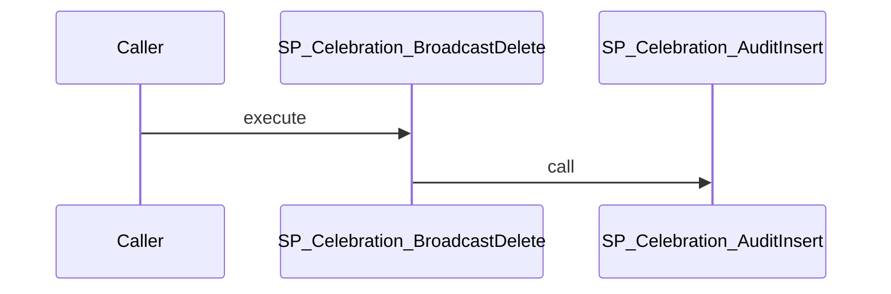
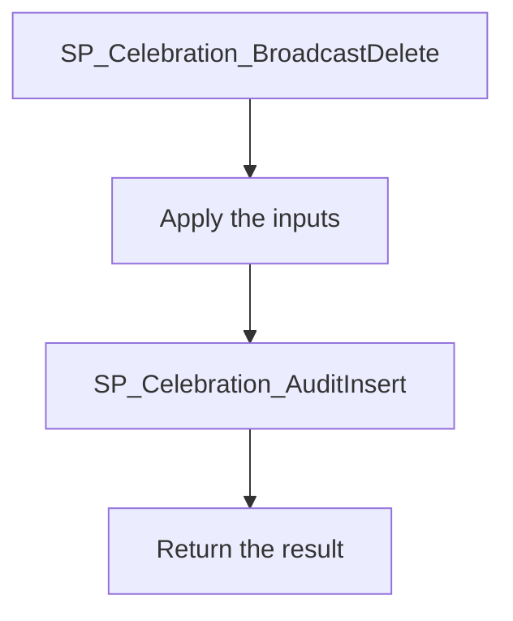

# SP_Celebration_BroadcastDelete

## What it does

Deletes or soft-cancels a broadcast according to status rules and writes an audit row.

## Parameters

| Name | Direction | What it is for |
|---|---|---|
| `@EmployerId` | in | Input (`INT`) |
| `@ActorEmployeeId` | in | Input (`INT`) |
| `@BroadcastId` | in | Input (`INT`) |

## Call sequence

## Callers

No other procedure or function under STOREPROCEDURE or FUNCTIONS executes this object.

## Nested

| Object | Kind | When | Page |
|---|---|---|---|
| `SP_Celebration_AuditInsert` | procedure | Called while this object runs | [SP_Celebration_AuditInsert](/docs/database/hrms/SP_Celebration_AuditInsert) |

## Steps

In `HRMS-DATABASE/HRMS/STOREPROCEDURE/161632/SP_Celebration_BroadcastDelete.sql`:

1. Deletes or soft-cancels a broadcast according to status rules and writes an audit row.
2. May return a validation `ResultCode` / `Message` result set instead of mutating when inputs fail checks.
4. Calls `SP_Celebration_AuditInsert` after a successful mutation.

## Tables

| Table | Read or write |
|---|---|
| `TCelebrationBroadcast` | write |

## Flow

