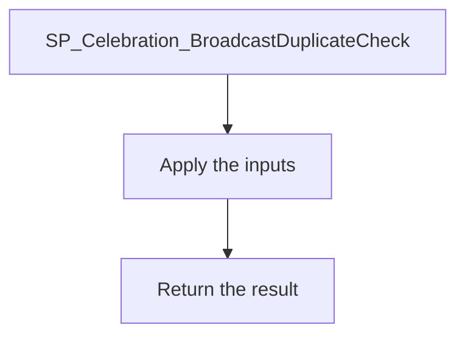

# SP_Celebration_BroadcastDuplicateCheck

## What it does

Checks whether a milestone broadcast already exists for the same employee, category, and event date.

## Parameters

| Name | Direction | What it is for |
|---|---|---|
| `@EmployerId` | in | Input (`INT`) |
| `@CategoryCode` | in | Input (`VARCHAR(30)`) |
| `@EmployeeId` | in | Input (`INT`) |
| `@EventDate` | in | Input (`DATE`) |
| `@ExcludeId` | in | Input (`INT`) |

## Call sequence

Calls no other procedures or functions.

## Callers

No other procedure or function under STOREPROCEDURE or FUNCTIONS executes this object.

## Nested

Calls no other procedures or functions.

## Steps

In `HRMS-DATABASE/HRMS/STOREPROCEDURE/161632/SP_Celebration_BroadcastDuplicateCheck.sql`:

1. Checks whether a milestone broadcast already exists for the same employee, category, and event date.

## Tables

| Table | Read or write |
|---|---|
| `TCelebrationBroadcast` | read |

## Flow

